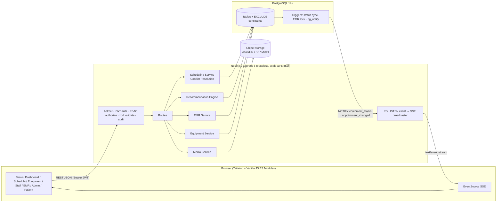
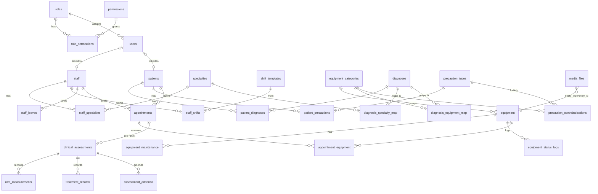
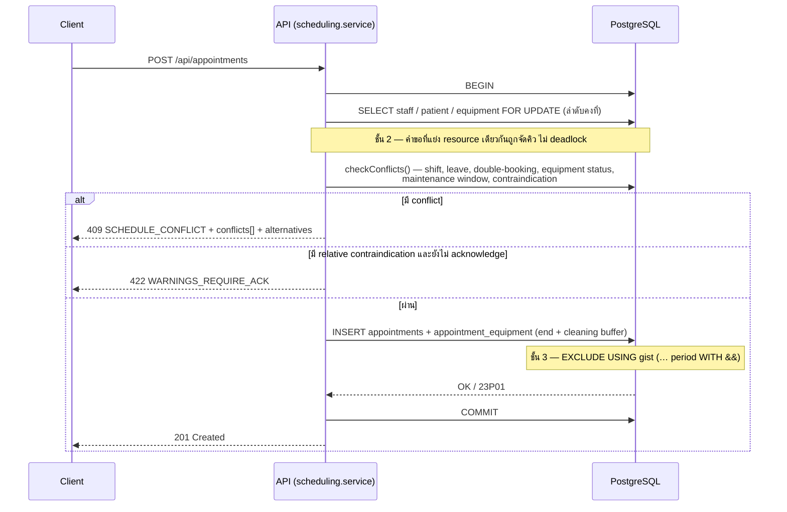

# PhysioCare — System Architecture

เอกสารนี้อธิบายสถาปัตยกรรม การออกแบบฐานข้อมูล และกลไกหลักของระบบบริหารจัดการห้องกายภาพบำบัด

## 1. ภาพรวมสถาปัตยกรรม



| Layer | เทคโนโลยี | เหตุผล |
|---|---|---|
| Frontend | HTML + Tailwind CSS + Vanilla JS (ES Modules), Chart.js | ไม่ต้อง build step, โหลดเร็ว, ย้ายไป React/Vue ได้ภายหลังโดยใช้ API เดิม |
| API | Node.js 20+, Express 5, zod, jsonwebtoken, bcryptjs, multer, helmet | Express 5 จัดการ async error ให้อัตโนมัติ |
| Database | PostgreSQL (btree_gist, pgcrypto) | `tstzrange` + `EXCLUDE` กันจองซ้อนได้ในระดับฐานข้อมูล, `LISTEN/NOTIFY` สำหรับ real-time |
| Real-time | Server-Sent Events | ทางเดียว (server → client) พอสำหรับสถานะอุปกรณ์/นัด, ผ่าน proxy ง่ายกว่า WebSocket |
| Storage | Local disk (driver pattern) | สลับเป็น S3/MinIO ได้โดยแก้ไฟล์เดียว `storage/local.js` |

### โครงสร้างโปรเจกต์

```
physiocare/
├── db/
│   ├── 001_schema.sql        # ตาราง, constraint, trigger, view
│   ├── 002_reference_data.sql      # ข้อมูลอ้างอิง (บทบาท, ICD-10, หมวดอุปกรณ์, ข้อห้ามใช้)
│   ├── 003_clinical_guidelines.sql # ฐานความรู้ตามแนวทางเวชปฏิบัติ (@repeatable)
│   └── demo/                       # ข้อมูลทดลอง — ห้ามใช้ใน production
├── deploy/                   # docker-compose, Caddyfile (HTTPS), backup.sh
├── Dockerfile
├── backend/
│   ├── src/
│   │   ├── app.js / server.js
│   │   ├── config.js, db.js, errors.js, time.js
│   │   ├── middleware/       # auth (JWT+RBAC), validate (zod), upload (multer), errorHandler
│   │   ├── services/         # availability, scheduling, recommendation, emr, equipment, media, audit, settings
│   │   ├── realtime/sse.js   # PG LISTEN → SSE
│   │   ├── storage/local.js  # storage driver
│   │   └── routes/           # REST endpoints
│   └── test/api.test.js      # integration tests (29 cases) กับ PostgreSQL จริง
└── frontend/
    ├── index.html
    └── js/{main,api,ui}.js + views/*.js
```

## 2. Database Schema



### กลุ่มตารางหลัก

| กลุ่ม | ตาราง | จุดเด่น |
|---|---|---|
| RBAC | `roles`, `permissions`, `role_permissions`, `users` | สิทธิ์ระดับ permission (ไม่ผูก role ตายตัวในโค้ด), ล็อกบัญชีเมื่อ login ผิด 5 ครั้ง |
| Staff Master | `staff`, `specialties`, `staff_specialties(level 1-5)`, `shift_templates`, `staff_shifts`, `staff_leaves` | `EXCLUDE` กันกะซ้อน, เลขใบอนุญาตบังคับสำหรับนักกายภาพ |
| Equipment Master | `equipment_categories`, `equipment`, `equipment_status_logs`, `equipment_maintenance` | สถานะ 5 แบบ, `cleaning_buffer_minutes` ต่อหมวด, วันที่ซื้อ/ราคา/ประกัน, รอบ PM อัตโนมัติ |
| Knowledge base | `diagnoses (ICD-10)`, `diagnosis_specialty_map`, `diagnosis_equipment_map`, `precaution_types`, `precaution_contraindications` | ข้อมูลที่ขับเคลื่อนระบบแนะนำ แก้ได้โดยไม่ต้องแก้โค้ด |
| Scheduling | `appointments`, `appointment_equipment` | `EXCLUDE` 3 ชั้น, `version` สำหรับ optimistic lock |
| EMR | `clinical_assessments(phase pre/post)`, `rom_measurements`, `treatment_records`, `assessment_addenda` | ลงนามแล้วแก้ไม่ได้ (trigger) |
| Media | `media_files` (polymorphic) | sha256, magic-byte validation, รูปหลัก 1 รูป/entity (partial unique index) |
| Ops | `system_settings`, `audit_logs` | ตั้งค่าเวลาทำการ/slot ได้จาก UI, audit ทุกการอ่าน EMR |

## 3. Smart Scheduling & Conflict Resolution

### 3.1 ป้องกันการจองซ้อน 3 ชั้น



| ชั้น | กลไก | กันอะไร |
|---|---|---|
| 1. Application check | `checkConflicts()` | ให้ข้อความที่อ่านเข้าใจได้ + เหตุผลทางคลินิก (กะ, ลา, ข้อห้าม, ช่วงซ่อม) |
| 2. Row locking | `SELECT … FOR UPDATE` บน staff → patient → equipment (เรียง id) | Race condition ระหว่าง check กับ insert |
| 3. DB constraint | `ex_therapist_double_booking`, `ex_patient_double_booking`, `ex_equipment_double_booking` | ด่านสุดท้าย แม้มีโค้ดอื่น/สคริปต์เขียน DB ตรง |

ทดสอบแล้ว: ยิง 5 คำขอพร้อมกันเข้า slot เดียวกัน → สำเร็จ 1, ได้ 409 อีก 4

### 3.2 ประเภท conflict

| Code | ความหมาย | ระดับ |
|---|---|---|
| `OUTSIDE_CLINIC_HOURS` | นอกเวลาทำการ (ตั้งค่าได้) | block |
| `STAFF_NOT_ON_SHIFT` / `STAFF_ON_LEAVE` / `STAFF_DOUBLE_BOOKED` | นักกายภาพไม่พร้อม | block |
| `PATIENT_DOUBLE_BOOKED` | ผู้ป่วยมีนัดซ้อน | block |
| `EQUIPMENT_UNAVAILABLE` | สถานะ maintenance / broken / retired | block |
| `EQUIPMENT_DOUBLE_BOOKED` | ถูกจองแล้ว (รวม cleaning buffer) | block |
| `EQUIPMENT_MAINTENANCE_WINDOW` | ทับช่วงปิดเครื่องที่วางแผนไว้ | block |
| `CONTRAINDICATED` | ข้อห้ามเด็ดขาด เช่น pacemaker + TENS | block |
| `RELATIVE_CONTRAINDICATION` | ใช้ด้วยความระมัดระวัง | ต้อง acknowledge |
| `STAFF_DAILY_CAP` | เกินโควตาผู้ป่วยต่อวัน | ต้อง acknowledge |

### 3.3 การเสนอทางเลือกอัตโนมัติ (เมื่อชน)

1. **sameTherapistSlots** — ช่องว่างที่ใกล้เวลาที่ขอที่สุดของนักกายภาพคนเดิม ภายใน 7 วัน (เช็คอุปกรณ์หมวดเดิมว่างด้วย)
2. **otherTherapistsSameTime** — นักกายภาพคนอื่นที่ว่าง ณ เวลาเดิม
3. **equipmentSubstitutes** — เครื่องอื่นในหมวดเดียวกันที่ว่าง ณ เวลาเดิม

### 3.4 Availability engine

`services/availability.js` โหลดกะ/ลา/นัด/การจองอุปกรณ์/ช่วงซ่อมของทั้งวันด้วย query ไม่กี่ครั้ง แล้วคำนวณช่องว่างในหน่วยความจำ (ใช้กับ slot finder และระบบแนะนำ) ส่วนการจองจริงยังผ่าน 3 ชั้นด้านบนเสมอ

เมื่อมีหลายเครื่องในหมวดเดียวกัน ระบบเลือกเครื่องที่ถูกใช้น้อยที่สุดในวันนั้น (wear leveling)

## 4. Diagnosis-to-Staff/Equipment Recommendation

```
Staff score = 0.55 × specialtyMatch + 0.15 × continuity + 0.15 × (1 − load/cap) + 0.15 × available

specialtyMatch = Σ_dx  w(dx) × max_specialty( weight(dx→specialty) × level/5 )  /  Σ w(dx)
                 โดย w = 2 สำหรับการวินิจฉัยหลัก, 1 สำหรับรอง
continuity    = จำนวนครั้งที่เคยรักษาผู้ป่วยรายนี้ / ค่าสูงสุดในกลุ่ม
```

อุปกรณ์:
1. หาหมวดอุปกรณ์จาก `diagnosis_equipment_map` (เลือก weight สูงสุดต่อหมวด + rationale)
2. ตรวจ `precaution_contraindications` กับข้อควรระวังของผู้ป่วย
   - `absolute` → ไม่แนะนำเครื่องใดเลย และเลือกใน UI ไม่ได้
   - `relative` → แสดงคำเตือน และต้องติ๊กยืนยันก่อนจอง
3. เลือกเครื่องที่ว่าง ณ เวลาที่ขอและมีชั่วโมงใช้งาน 30 วันน้อยที่สุด

ตัวอย่างจากข้อมูลทดสอบ: ผู้ป่วย Stroke (I63.9) ที่ใส่ pacemaker และเสี่ยงล้ม
→ แนะนำ กภ.สุภาพร (Neuro 5/5) คะแนน 85%, ราวคู่ฝึกเดิน, เตียงปรับยืน (⚠ เสี่ยงล้ม), ไม่แนะนำ NMES (⛔ pacemaker)

### 4.1 ฐานความรู้ตามแนวทางเวชปฏิบัติ (`db/003_clinical_guidelines.sql`)

| ตาราง | เนื้อหา |
|---|---|
| `clinical_sources` | แนวทางเวชปฏิบัติที่อ้างอิง (องค์กร, ปี, URL) |
| `diagnosis_interventions` | วิธีรักษาที่ไม่ใช้อุปกรณ์ต่อโรค: ประเภท, ระดับคำแนะนำ, เกรด, ขนาด/ความถี่, หมายเหตุ, แหล่งอ้างอิง |
| `diagnosis_equipment_map` + `recommendation, grade, source_id` | ระดับคำแนะนำของอุปกรณ์แต่ละหมวดต่อโรค |
| `diagnoses.summary_th, red_flags` | สรุปแนวทางและ red flags |

ระดับคำแนะนำ: `recommended` (แนะนำ) · `optional` (เสริมได้) · `insufficient` (หลักฐานไม่พอ) · `not_recommended` (ไม่แนะนำ)

- ระบบแนะนำจัดอันดับตามระดับคำแนะนำก่อน แล้วจึงตาม weight; หมวด `not_recommended` จะไม่ถูกเลือกเครื่องให้อัตโนมัติ (นักกายภาพยังเลือกเองได้ตามดุลยพินิจ)
- เมื่อผู้ป่วยมีหลายโรค ใช้ระดับคำแนะนำที่ดีที่สุดในบรรดาโรคเหล่านั้น และแสดงว่ามาจากโรคใด
- เกรดเป็นไปตามระบบของแต่ละองค์กร (JOSPT A–F, NICE offer/consider/do not offer, AHA COR/LOE, Novak traffic light) จึงเปรียบเทียบข้ามองค์กรตรง ๆ ไม่ได้
- ข้อจำกัดที่ทราบ: เกรดของ rotator cuff (JOSPT 2025) มาจากบทสรุปทุติยภูมิ, plantar fasciitis (JOSPT 2023) มาจากร่างก่อนตีพิมพ์, บางรายการของ AHA 2026 และ NICE NG236 มาจากแหล่งทุติยภูมิ — ควรตรวจกับฉบับเต็ม

> ⚠ ฐานความรู้นี้เป็นเครื่องมือช่วยตัดสินใจ ไม่ใช่คำสั่งการรักษา คณะทำงานวิชาการของคลินิกควรทบทวนก่อนใช้งานจริงและทบทวนซ้ำเมื่อแนวทางฉบับใหม่ออก ค่า weight ความเชี่ยวชาญและกฎข้อห้ามใน `002_reference_data.sql` ยังเป็นค่าตัวอย่าง

## 5. EMR & Clinical Assessment

| ส่วน | ข้อมูล |
|---|---|
| Pre-Treatment | Pain NRS 0–10, ตำแหน่ง/ลักษณะปวด, Vital signs, Subjective, Red flags, **ทบทวนข้อควรระวังแล้ว** (ต้องติ๊ก), ROM |
| Post-Treatment | Pain หลังรักษา, การตอบสนอง (improved/unchanged/worsened), การรักษาที่ให้ (เชื่อมกับอุปกรณ์ + parameters JSON), Assessment, Home program, แผนนัดถัดไป, ROM, functional scores (ODI/NDI/Berg ฯลฯ) |

กฎ
- เริ่มรักษา (`in_progress`) ไม่ได้จนกว่าจะมี Pre-assessment ที่มี pain score และทบทวนข้อควรระวังแล้ว (ปิดได้ที่ `emr.require_pre_assessment`)
- แก้แบบร่างได้เฉพาะผู้บันทึก, ลงนามได้เมื่อข้อมูลครบ
- ลงนามแล้ว trigger `trg_protect_signed_assessment` ห้าม UPDATE/DELETE ทั้งแบบประเมินและ ROM/treatment ลูก ต้องเพิ่มข้อมูลทาง **Addendum** เท่านั้น
- หน้า Pre-assessment แสดงสรุปนัดก่อนหน้า (pain, ROM, home program, แผน) และคำนวณ Δ ROM แบบสดขณะกรอก
- `GET /api/emr/patients/:id/progress` คืน pain timeline และ ROM series พร้อม `changeFromBaseline`, `changeFromPrevious`, `pctOfNormal`

## 6. RBAC

| Permission | Admin | Therapist | Staff | Patient |
|---|:-:|:-:|:-:|:-:|
| users:manage, settings:manage, reports:view, audit:read | ✅ | | | |
| equipment:read / equipment:status / maintenance:write | ✅ | ✅ | ✅ | |
| equipment:write, staff:write | ✅ | | | |
| staff:read | ✅ | ✅ | ✅ | |
| shifts:write | ✅ | | ✅ | |
| patients:read / patients:write | ✅ | ✅ | ✅ | |
| appointments:read_all / appointments:write | ✅ | ✅ | ✅ | |
| emr:read / emr:write | | ✅ | | |
| media:upload | ✅ | ✅ | ✅ | |
| appointments:read_own | | | | ✅ |

- ตรวจสิทธิ์ที่ middleware `authorize(...perms)` ทุก route และ cache สิทธิ์ตาม role 60 วินาที (แก้ใน DB แล้วมีผลโดยไม่ต้อง login ใหม่)
- **Row-level**: ผู้ป่วยถูกบังคับ `patient_id = ตนเอง` และได้ข้อมูลแบบตัดฟิลด์ภายในออก
- Admin ไม่มีสิทธิ์อ่าน EMR ตามหลัก least privilege สำหรับข้อมูลสุขภาพ (PDPA มาตรา 26)

## 7. Real-time

1. Trigger `trg_equipment_status_change` → INSERT `equipment_status_logs` + `pg_notify('equipment_status', …)`
2. Trigger `trg_appointment_status_sync` → `in_progress` ตั้งอุปกรณ์ที่จองเป็น `in_use`, `completed/cancelled/no_show` คืนเป็น `available`, `cancelled` ปลด reservation, จบก่อนเวลาคืนช่วงเวลาที่เหลือ + `pg_notify('appointment_changed', …)`
3. ทุก API instance `LISTEN` แล้ว push ผ่าน SSE `/api/realtime/stream` ให้ client ที่มีสิทธิ์ของ channel นั้น จึงทำงานได้แม้มีหลาย instance โดยไม่ต้องใช้ Redis

## 8. Media (รูปภาพ)

- `POST /api/media/:entityType/:entityId` (field `images`, สูงสุด 10 ไฟล์, ไฟล์ละไม่เกิน 5MB)
- ตรวจชนิดไฟล์จาก magic bytes (JPEG/PNG/WebP) ไม่เชื่อ mimetype ที่ client ส่งมา, เก็บ sha256, ตั้งชื่อไฟล์เป็น UUID, กัน path traversal
- สิทธิ์อ่าน/เขียนตาม entity: อุปกรณ์ใช้ `equipment:*`, รูปผู้ป่วยใช้ `patients:*`, รูปในเวชระเบียนใช้ `emr:*` (ลบไม่ได้)
- เสิร์ฟผ่าน `GET /api/media/:id` พร้อมตรวจสิทธิ์และ ETag (ไม่เปิด static folder ตรง)

## 9. Security & Compliance

- bcrypt password hash, ล็อกบัญชีเมื่อ login ผิด 5 ครั้ง (15 นาที), password policy
- JWT ใน `Authorization` header สำหรับทุกคำสั่ง; cookie `HttpOnly; SameSite=Strict` รับเฉพาะ GET (ใช้กับ `` และ EventSource) จึงไม่เปิดช่อง CSRF
- helmet + CSP, validate input ทุก endpoint ด้วย zod, SQL ใช้ parameterized query ทั้งหมด
- Audit log สำหรับ login, การอ่าน/เขียน EMR, การดูรูปผู้ป่วย และการเปลี่ยนแปลง master data

## 10. API Reference (สรุป)

| Method | Endpoint | Permission |
|---|---|---|
| POST | `/api/auth/login`, `/api/auth/logout` · GET `/api/auth/me` | – |
| GET/POST/PATCH | `/api/users`, `/api/users/roles` | users:manage |
| GET · PUT | `/api/settings` · `/api/settings/:key` | any · settings:manage |
| GET | `/api/equipment?status&categoryId&q`, `/api/equipment/categories`, `/api/equipment/:id` | equipment:read |
| POST · PATCH | `/api/equipment` · `/api/equipment/:id` | equipment:write |
| PATCH | `/api/equipment/:id/status` → คืน `affectedAppointments` + `substitutes` | equipment:status |
| POST · PATCH | `/api/equipment/:id/maintenance` · `/api/equipment/maintenance/:id` | maintenance:write |
| GET | `/api/staff`, `/api/staff/:id`, `/api/staff/specialties`, `/api/staff/shift-templates`, `/api/staff/shifts?from&to` | staff:read |
| POST/PATCH/PUT | `/api/staff`, `/api/staff/:id`, `/api/staff/:id/specialties` | staff:write |
| POST · DELETE | `/api/staff/:id/shifts` (bulk), `/api/staff/:id/leaves` · `/api/staff/shifts/:id` | shifts:write |
| GET/POST/PATCH | `/api/patients`, `/api/patients/:id`, `/api/patients/:id/diagnoses`, `/api/patients/:id/precautions` | patients:* |
| GET | `/api/patients/me`, `/api/patients/diagnoses`, `/api/patients/precaution-types` | login |
| GET | `/api/scheduling/recommendations?patientId&startAt&durationMin` | appointments:write |
| GET | `/api/scheduling/slots?date&durationMin&patientId&therapistIds&categoryIds` | appointments:write |
| POST | `/api/scheduling/check` (dry-run + alternatives) | appointments:write |
| GET | `/api/appointments?from&to&therapistId&patientId&status`, `/api/appointments/:id` | read_all / read_own |
| POST · PATCH | `/api/appointments` · `/:id/reschedule` (version) · `/:id/status` | appointments:write |
| GET · PUT | `/api/emr/appointments/:id` · `/api/emr/appointments/:id/{pre,post}` | emr:read · emr:write |
| POST | `/api/emr/assessments/:id/sign`, `/api/emr/assessments/:id/addenda` | emr:write |
| GET | `/api/emr/patients/:id/progress` | emr:read |
| POST · GET · PATCH · DELETE | `/api/media/:type/:id` · `/api/media/:id` · `/api/media/:id/primary` · `/api/media/:id` | ตาม entity |
| GET | `/api/reports/summary?from&to`, `/api/reports/equipment-alerts`, `/api/reports/audit` | reports:view / audit:read |
| GET | `/api/realtime/stream` (SSE) | equipment:read / appointments:read_all |

## 11. แนวทางต่อยอดสู่ Production

ขั้นตอน deploy ปัจจุบัน (Docker Compose + Caddy + backup) อยู่ที่ [DEPLOYMENT.md](DEPLOYMENT.md)


- **Build Tailwind** ด้วย Tailwind CLI แทน Play CDN และ self-host Chart.js
- **Refresh token / session revocation** และ MFA สำหรับบทบาทที่เข้าถึง EMR
- **Storage** ย้ายไป S3/MinIO + presigned URL, สร้าง thumbnail (sharp) และสแกนไวรัส
- **Migration:** มีตัวรัน `backend/scripts/migrate.js` แล้ว (บันทึกใน `schema_migrations`) — ถ้าทีมใหญ่ขึ้นและต้องการ down migration ให้พิจารณา node-pg-migrate / Flyway
- **Notification**: เตือนนัดผ่าน LINE/SMS ด้วย job queue (pg-boss) และรับ event จาก `appointment_changed`
- **Rooms/Beds** เป็น resource ที่ 4 ใช้รูปแบบเดียวกับ `appointment_equipment` (EXCLUDE constraint)
- **Integration** กับ HIS ผ่าน HL7 FHIR (`Appointment`, `Observation` สำหรับ pain/ROM, `Procedure`)
- **Observability**: structured logging (pino), metrics, การ backup และ PITR ของ PostgreSQL
