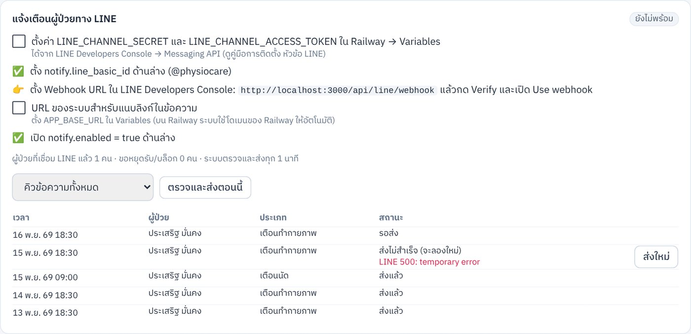

# ตั้งค่าการแจ้งเตือนผู้ป่วยทาง LINE

PhysioCare ส่งข้อความหาผู้ป่วยผ่าน **LINE Official Account (LINE OA) ของคลินิกเอง** เช่น

- **เตือนนัด:** ล่วงหน้า 24 ชั่วโมง ปรับได้
- **เตือนทำกายภาพที่บ้าน:** ทุกวันที่มีท่าต้องทำ ตามเวลาที่นักกายภาพตั้ง และงดส่งถ้าผู้ป่วยบันทึกวันนั้นแล้ว

ฟังก์ชันนี้**ไม่บังคับ** ถ้ายังไม่ตั้งค่า ระบบส่วนอื่นทำงานได้ตามปกติ

> **ข้อความไม่มีข้อมูลการรักษา:** ไม่มี HN ไม่มีชื่อโรค มีเพียงชื่อจริงของผู้ป่วย ชื่อนักกายภาพ วันเวลานัด และลิงก์โปรแกรมที่บ้าน
>
> **ผู้ป่วยยกเลิกได้เอง:** พิมพ์ "หยุด" ในแชต และพิมพ์ "เริ่ม" เพื่อรับใหม่

## สิ่งที่ต้องเตรียม

- บัญชี LINE ของผู้ดูแลระบบคลินิก
- สิทธิ์แก้ Variables ของ service PhysioCare บน Railway (หรือไฟล์ `.env` บนเซิร์ฟเวอร์)
- สิทธิ์ผู้ดูแลระบบใน PhysioCare
- ใช้เวลาประมาณ 20 นาที

## ขั้นที่ 1 สร้าง LINE Official Account

1. เข้า **LINE Official Account Manager** (manager.line.biz) แล้ว login ด้วย LINE ของผู้ดูแลระบบ
2. กด **สร้างบัญชี** แล้วกรอกข้อมูล:
   - ชื่อบัญชี: ชื่อคลินิก ซึ่งผู้ป่วยจะเห็น
   - ประเภทธุรกิจ: การแพทย์/สุขภาพ
3. จดเลข **Basic ID** ที่ขึ้นต้นด้วย `@` เช่น `@123abcde` (ดูได้ที่หน้าแรกของบัญชี)

> ค่าบริการ: แพ็กเกจฟรีส่งข้อความได้จำนวนจำกัดต่อเดือน
>
> - ประมาณการ: ผู้ป่วย 1 คนที่มีโปรแกรมที่บ้านใช้ราว 20–30 ข้อความต่อเดือน (เตือนเฉพาะวันที่ยังไม่บันทึก) บวกเตือนนัด 1 ข้อความต่อนัด
> - ตรวจโควตาและราคาปัจจุบันในหน้า **ราคา/แพ็กเกจ** ของ LINE OA ก่อนเปิดใช้กับผู้ป่วยจำนวนมาก
> - ข้อความตอบกลับอัตโนมัติ เช่น "เชื่อมต่อสำเร็จ" ไม่นับโควตา

## ขั้นที่ 2 เปิด Messaging API

1. ใน LINE Official Account Manager ไปที่ **ตั้งค่า** → **Messaging API** → **ใช้ Messaging API**
2. เลือกหรือสร้าง **Provider** เช่น ใช้ชื่อคลินิก แล้วยืนยัน
3. เข้า **LINE Developers Console** (developers.line.biz) จะเห็น channel ของบัญชีนี้ใต้ Provider

## ขั้นที่ 3 คัดลอกรหัสลับ 2 ค่า

ใน LINE Developers Console เปิด channel นั้น แล้วคัดลอก:

| ค่า | อยู่ที่ |
|---|---|
| **Channel secret** | แท็บ **Basic settings** |
| **Channel access token (long-lived)** | แท็บ **Messaging API** → ด้านล่างสุด กด **Issue** |

> ⚠ ทั้งสองค่าเป็น**รหัสลับ** ห้ามส่งทางอีเมล แชต หรือเก็บในเอกสาร ให้วางลงช่อง Variables ในขั้นถัดไปโดยตรงเท่านั้น
>
> ถ้าสงสัยว่ารั่ว ให้กด **Issue** ใหม่ (token เดิมใช้ไม่ได้ทันที) แล้วแก้ Variables

## ขั้นที่ 4 ใส่ค่าใน Railway

service `physiocare` → **Variables** → **New Variable**:

| ตัวแปร | ค่า |
|---|---|
| `LINE_CHANNEL_SECRET` | Channel secret จากขั้นที่ 3 |
| `LINE_CHANNEL_ACCESS_TOKEN` | Channel access token จากขั้นที่ 3 |
| `APP_BASE_URL` | (ไม่บังคับบน Railway) URL ของระบบ เช่น `https://physiocare.up.railway.app` หรือโดเมนของคลินิก — ระบบใช้แนบลิงก์ในข้อความ ถ้าไม่ใส่ ระบบใช้โดเมนของ Railway ให้อัตโนมัติ **ถ้าใช้โดเมนของคลินิก ให้ใส่ค่านี้** |

Railway จะ deploy ใหม่ให้เอง (ประมาณ 1–2 นาที)

> **ติดตั้งบนเซิร์ฟเวอร์ของคลินิก:**
>
> 1. เพิ่มบรรทัด `LINE_CHANNEL_SECRET=...`, `LINE_CHANNEL_ACCESS_TOKEN=...` และ `APP_BASE_URL=https://โดเมนของคลินิก` ในไฟล์ `.env`
> 2. รัน `docker compose up -d`

## ขั้นที่ 5 ตั้ง Webhook

Webhook คือช่องทางที่ LINE แจ้งระบบเมื่อผู้ป่วยส่งรหัสเชื่อมต่อ พิมพ์ "หยุด" หรือบล็อกบัญชี

1. login PhysioCare ด้วยบัญชีผู้ดูแลระบบ → เมนู **ผู้ใช้ & ตั้งค่า** → การ์ด **แจ้งเตือนผู้ป่วยทาง LINE** → คัดลอก Webhook URL เช่น `https://physiocare.up.railway.app/api/line/webhook`
2. LINE Developers Console → แท็บ **Messaging API** → **Webhook settings**:
   - วาง URL ในช่อง **Webhook URL** → กด **Update**
   - กด **Verify** ต้องขึ้น **Success**
   - เปิดสวิตช์ **Use webhook**
3. ในส่วน **LINE Official Account features** ของหน้าเดียวกัน กดแก้ไข แล้วตั้งค่าดังนี้:
   - **Auto-reply messages:** ปิด (ไม่อย่างนั้นผู้ป่วยจะได้ข้อความตอบกลับซ้ำ 2 ข้อความ)
   - **Greeting messages:** ปิดได้ (ระบบส่งข้อความต้อนรับให้แล้ว)

## ขั้นที่ 6 เปิดใช้งานใน PhysioCare

เมนู **ผู้ใช้ & ตั้งค่า** → ตาราง **ตั้งค่าระบบ** แก้ค่าแล้วกด **บันทึก** ทีละแถว:

| ค่า | ใส่ | ความหมาย |
|---|---|---|
| `notify.line_basic_id` | `"@123abcde"` | Basic ID จากขั้นที่ 1 (มีเครื่องหมายคำพูด) ใช้สร้าง QR ให้ผู้ป่วยสแกน |
| `clinic.name` | `"คลินิกกายภาพ..."` | ชื่อที่ขึ้นในข้อความ |
| `notify.enabled` | `true` | เปิดส่งข้อความ (ตั้ง `false` เพื่อหยุดทั้งหมดทันที) |
| `notify.appointment_hours` | `[24]` | เตือนนัดล่วงหน้ากี่ชั่วโมง เช่น `[24, 2]` = เตือน 2 ครั้ง |
| `notify.home_reminder_time` | `"18:00"` | เวลาเตือนทำกายภาพ ถ้านักกายภาพไม่ได้ตั้งเวลาเฉพาะคน |
| `notify.quiet_hours` | `{"start":"21:00","end":"07:00"}` | ช่วงห้ามส่ง ข้อความที่ตรงช่วงนี้จะเลื่อนไปส่งก่อนเริ่มช่วงห้ามส่ง |

การ์ด **แจ้งเตือนผู้ป่วยทาง LINE** จะขึ้น ✅ ครบและป้าย **พร้อมส่ง**

## ขั้นที่ 7 ทดสอบกับตัวเอง

1. สร้างผู้ป่วยทดสอบ (หรือใช้ข้อมูลของตัวเอง) → เปิดหน้าต่างผู้ป่วย → ส่วน **แจ้งเตือนทาง LINE** → **เชื่อม LINE**
2. สแกน QR ด้วยกล้องมือถือ → LINE เปิดแชตของคลินิกพร้อมข้อความ `เชื่อมต่อ XXXXXX` → กดส่ง
3. LINE ตอบว่าเชื่อมต่อสำเร็จ → กลับมากด **รีเฟรชสถานะ** ต้องขึ้น **เชื่อม LINE แล้ว**
4. กด **ส่งข้อความทดสอบ** แล้วตรวจว่าได้รับข้อความ
5. พิมพ์ `หยุด` ในแชต → สถานะเปลี่ยนเป็น **ผู้ป่วยขอหยุดรับข้อความ** · พิมพ์ `เริ่ม` เพื่อกลับมารับ

## การใช้งานประจำวัน

- **เชื่อม LINE ให้ผู้ป่วย** ทำได้ 2 ทาง:
  - เจ้าหน้าที่เปิดหน้าต่างผู้ป่วย → **เชื่อม LINE** → ให้ผู้ป่วยสแกน QR (รหัสใช้ได้ 7 วัน)
  - ผู้ป่วยกด **เชื่อมต่อ LINE** ในหน้าโปรแกรมที่บ้านของตัวเอง
- **ตั้งเวลาเตือนรายคน:** นักกายภาพตั้งในหน้า **แก้ไขโปรแกรม** ช่อง **เตือนทาง LINE เวลา**
- **ตรวจคิวข้อความ:** การ์ดในหน้าผู้ดูแลระบบแสดง 200 ข้อความล่าสุด
  - กรองดูเฉพาะที่ **ส่งไม่สำเร็จ** ได้
  - ข้อความที่ส่งไม่สำเร็จจะลองใหม่เองสูงสุด 8 ครั้ง (เว้นระยะห่างขึ้นเรื่อย ๆ)
  - กด **ส่งใหม่** เพื่อลองอีกครั้งทันที
- ระบบตรวจและส่งทุก 1 นาที · กด **ตรวจและส่งตอนนี้** เพื่อสั่งรอบทันที

## แก้ปัญหา

| อาการ | สาเหตุที่พบบ่อย / วิธีแก้ |
|---|---|
| Verify ใน LINE ขึ้น 401 | `LINE_CHANNEL_SECRET` ไม่ตรงกับ channel หรือยังไม่ deploy ใหม่หลังแก้ Variables |
| Verify ขึ้น 404 / timeout | Webhook URL พิมพ์ผิด หรือระบบยังไม่เปิด — ลองเปิด `https://โดเมน/api/health` |
| ผู้ป่วยส่งรหัสแล้วไม่มีอะไรตอบ | ยังไม่ได้เปิด **Use webhook** หรือรหัสหมดอายุ (เกิน 7 วัน) — สร้าง QR ใหม่ |
| ผู้ป่วยได้ข้อความตอบ 2 ข้อความ | ยังไม่ปิด **Auto-reply messages** ใน LINE OA |
| คิวขึ้น `LINE 401` | access token ผิดหรือถูกออกใหม่ — Issue token ใหม่แล้วแก้ Variables |
| คิวขึ้น `LINE 429` | เกินโควตาข้อความของเดือน หรือส่งถี่เกิน — ระบบจะลองใหม่ภายหลัง ตรวจแพ็กเกจใน LINE OA |
| สถานะ **ผู้ป่วยบล็อก LINE ของคลินิก** | ผู้ป่วยบล็อกบัญชี ระบบหยุดส่งให้เอง ถ้าผู้ป่วยปลดบล็อกระบบจะส่งต่อเอง |

## ความเป็นส่วนตัว (PDPA)

- ระบบเก็บเฉพาะ **LINE user ID** และชื่อที่แสดงใน LINE ของผู้ป่วยที่เชื่อมเอง
  - ID นี้ใช้ส่งข้อความได้เฉพาะผ่าน LINE OA ของคลินิก
- ข้อความไม่มีข้อมูลการรักษา
  - ลิงก์ในข้อความเป็นลิงก์โปรแกรมที่บ้านแบบเดิม ซึ่งยกเลิกได้ที่หน้า **ลิงก์ & QR**
- **ยกเลิกการเชื่อม** ในหน้าต่างผู้ป่วยจะลบ LINE user ID ออกทันที
- เนื้อหาข้อความผ่านเซิร์ฟเวอร์ของ LINE ควรแจ้งในประกาศความเป็นส่วนตัวของคลินิกว่าใช้ LINE ส่งการแจ้งเตือน
