# คู่มือการใช้งาน PhysioCare

คู่มือนี้สำหรับผู้ใช้งานประจำวันของคลินิกกายภาพบำบัด: เจ้าหน้าที่หน้าเคาน์เตอร์ นักกายภาพบำบัด ผู้ดูแลระบบ และผู้ป่วย
ภาพหน้าจอทั้งหมดในคู่มือนี้มาจากข้อมูลทดลอง ไม่ใช่ข้อมูลผู้ป่วยจริง

## ใครเห็นเมนูอะไร

เมนูด้านซ้ายแสดงตามสิทธิ์ของแต่ละบัญชี ผู้ใช้จะเห็นเฉพาะเมนูที่ใช้ได้

| เมนู | เจ้าหน้าที่ | นักกายภาพ | ผู้ดูแลระบบ | ผู้ป่วย |
|---|:-:|:-:|:-:|:-:|
| ภาพรวม | ✓ | ✓ | ✓ | |
| ผู้ป่วย | ✓ | ✓ | ✓ | |
| ตารางนัดหมาย / จองนัด | ✓ | ✓ | ✓ | |
| เวชระเบียน (เปิดจากนัดหมาย) | | ✓ | | |
| ติดตามที่บ้าน (โปรแกรมกายภาพที่บ้าน) | | ✓ | | |
| อุปกรณ์ (ดู / เปลี่ยนสถานะ / บันทึกซ่อม) | ✓ | ✓ | ✓ | |
| อุปกรณ์ (เพิ่ม / แก้ทะเบียน) | | | ✓ | |
| ผัง 3D, ห้อง & เตียง | ✓ | ✓ | ✓ | |
| บุคลากร & กะ (ดู) | ✓ | ✓ | ✓ | |
| บุคลากร & กะ (จัดกะ / วันลา) | ✓ | | ✓ | |
| แนวทางการรักษา | ✓ | ✓ | ✓ | |
| รายงานสถิติ, ผู้ใช้ & ตั้งค่า, เชื่อมต่อ HIS | | | ✓ | |
| นัดหมายของฉัน | | | | ✓ |
| หน้าโปรแกรมที่บ้าน (เปิดจากลิงก์/QR ไม่ต้องมีบัญชี) | | | | ✓ และญาติ |

> ผู้ดูแลระบบ**ไม่เห็นเวชระเบียน**โดยตั้งใจ ข้อมูลสุขภาพเปิดได้เฉพาะนักกายภาพ ตามหลักให้สิทธิ์เท่าที่จำเป็นของ PDPA

# 1. เริ่มต้นใช้งาน

## เข้าสู่ระบบ

1. เปิดเว็บไซต์ของระบบที่คลินิกแจ้ง
2. กรอกอีเมลและรหัสผ่าน แล้วกด **เข้าสู่ระบบ**

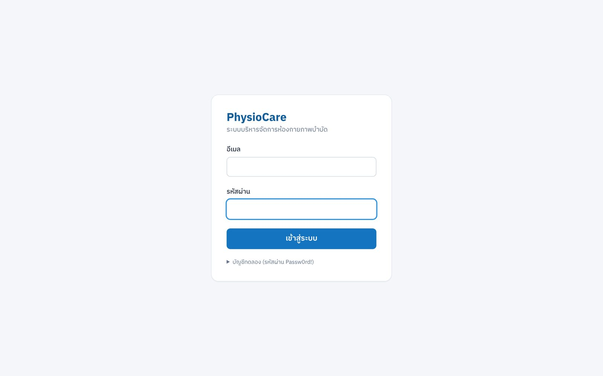

- การเข้าระบบมีอายุ 8 ชั่วโมง ครบแล้วระบบให้เข้าสู่ระบบใหม่
- กรอกรหัสผ่านผิดหลายครั้ง ระบบจะล็อกบัญชีชั่วคราว ให้รอสักครู่หรือแจ้งผู้ดูแลระบบ
- **ลืมรหัสผ่าน:** แจ้งผู้ดูแลระบบให้ตั้งรหัสผ่านใหม่ (หัวข้อ 12)
- **ออกจากระบบ:** กด "ออกจากระบบ" มุมซ้ายล่าง ทุกครั้งที่ใช้เครื่องร่วมกับผู้อื่น

## ส่วนต่าง ๆ ของหน้าจอ

- **เมนูซ้าย:** ไปยังแต่ละหน้า
- **มุมซ้ายล่าง:** ชื่อผู้ใช้ บทบาท และจุดสถานะ **live** (สีเขียว = ข้อมูลอัปเดตเองแบบ real-time เมื่อมีคนจองนัดหรือเปลี่ยนสถานะเครื่อง)
- **ข้อความแจ้งผล:** ขึ้นที่มุมขวาล่างหลังกดบันทึก (เขียว = สำเร็จ, แดง = ไม่สำเร็จพร้อมเหตุผล)

# 2. ภาพรวมวันนี้

หน้าแรกของเจ้าหน้าที่และนักกายภาพ แสดงสิ่งที่ต้องรู้ของวันนี้ในหน้าเดียว

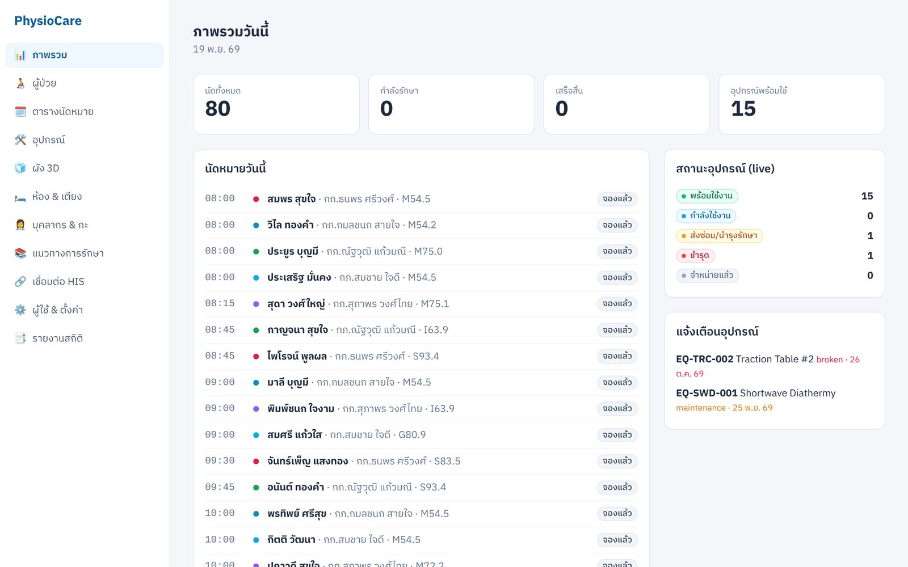

- **ตัวเลขด้านบน:** นัดทั้งหมดวันนี้ กำลังรักษา เสร็จสิ้น และจำนวนอุปกรณ์พร้อมใช้
- **นัดหมายวันนี้:** เรียงตามเวลา พร้อมนักกายภาพ การวินิจฉัย และสถานะ
- **สถานะอุปกรณ์ (live):** จำนวนเครื่องพร้อมใช้ / กำลังใช้ / ซ่อม / ชำรุด
- **แจ้งเตือนอุปกรณ์:** เครื่องที่ถึงรอบบำรุงรักษาหรือเลยกำหนด

# 3. ผู้ป่วย

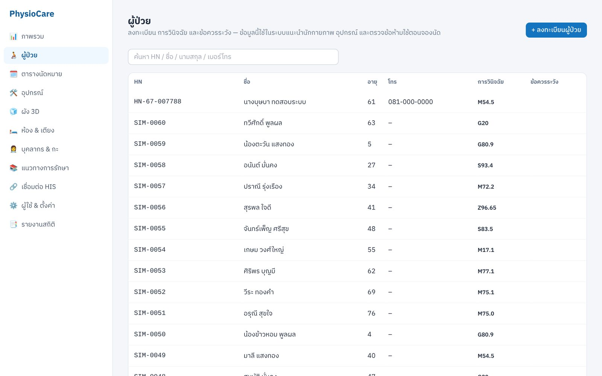

## ลงทะเบียนผู้ป่วยใหม่

1. เมนู **ผู้ป่วย** → **+ ลงทะเบียนผู้ป่วย**
2. กรอก HN ชื่อ นามสกุล (บังคับ) และวันเกิด เพศ โทร ที่อยู่ ประวัติแพ้ ผู้ติดต่อฉุกเฉิน
3. กด **ลงทะเบียน** ระบบเปิดหน้าข้อมูลผู้ป่วยให้เพิ่มการวินิจฉัยต่อทันที

> HN ห้ามซ้ำกับผู้ป่วยคนอื่น ถ้าซ้ำระบบจะแจ้งและไม่บันทึก

## การวินิจฉัยและข้อควรระวัง (สำคัญต่อการจองนัด)

คลิกชื่อผู้ป่วยเพื่อเปิดหน้าข้อมูล

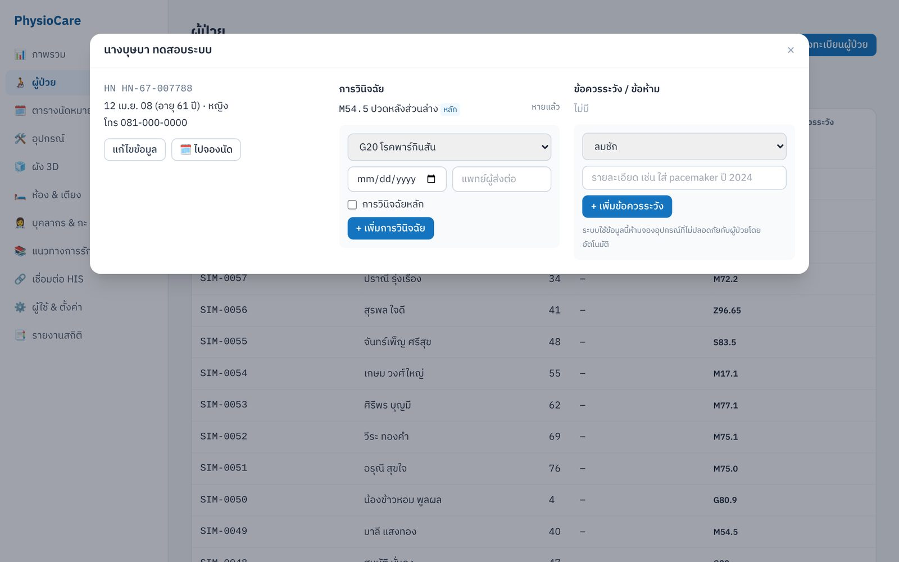

- **+ เพิ่มการวินิจฉัย:** เลือกโรค (ICD-10) ระบบใช้ข้อมูลนี้แนะนำนักกายภาพที่ถนัดโรคนั้น และแนะนำอุปกรณ์ตามแนวทางเวชปฏิบัติ
  - โรคหลักติ๊ก "การวินิจฉัยหลัก" · หายแล้วกด **หายแล้ว**
- **+ เพิ่มข้อควรระวัง:** เช่น ใส่เครื่องกระตุ้นหัวใจ (pacemaker) ตั้งครรภ์ มีโลหะในร่างกาย เสี่ยงล้ม
  - ระบบจะ**ไม่ให้เลือกอุปกรณ์ที่ห้ามใช้**กับผู้ป่วยคนนั้น (เช่น เครื่องกระตุ้นไฟฟ้ากับผู้ใส่ pacemaker) และเตือนก่อนจองเมื่อเป็นข้อควรระวังแบบสัมพัทธ์
- **แก้ไขข้อมูล:** แก้ข้อมูลทั่วไปของผู้ป่วย

> ถ้าเชื่อมต่อระบบโรงพยาบาล (HIS) ไว้ ช่องที่มาจาก HIS (เช่น HN ชื่อ วันเกิด) จะเป็นสีเทาแก้ไม่ได้ ให้แก้ที่ระบบโรงพยาบาล ส่วนช่องอื่นแก้ได้ตามปกติ

# 4. ตารางนัดหมาย

เมนู **ตารางนัดหมาย** มี 4 มุมมอง เลือกได้ที่ปุ่มด้านบน: **วัน · ตามเตียง · สัปดาห์ · เดือน**

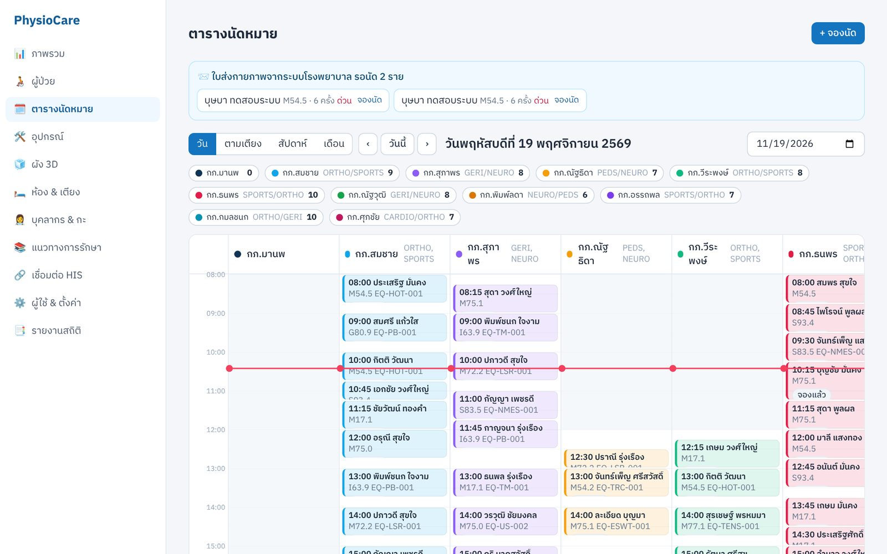

- **วัน:** หนึ่งคอลัมน์ต่อนักกายภาพ ช่วงสีเทาคือนอกกะหรือวันลา เส้นแดงคือเวลาปัจจุบัน
- **ตามเตียง:** หนึ่งคอลัมน์ต่อเตียง/ห้อง ใช้ดูว่าเตียงไหนว่าง
- **สัปดาห์ / เดือน:** ภาพรวมระยะยาว กดตัวเลขวันเพื่อดูวันนั้น
- ปุ่ม **‹ วันนี้ ›** และช่องวันที่ใช้เลื่อนดูวันอื่น · กดชื่อนักกายภาพในแถบด้านบนเพื่อซ่อน/แสดงคอลัมน์

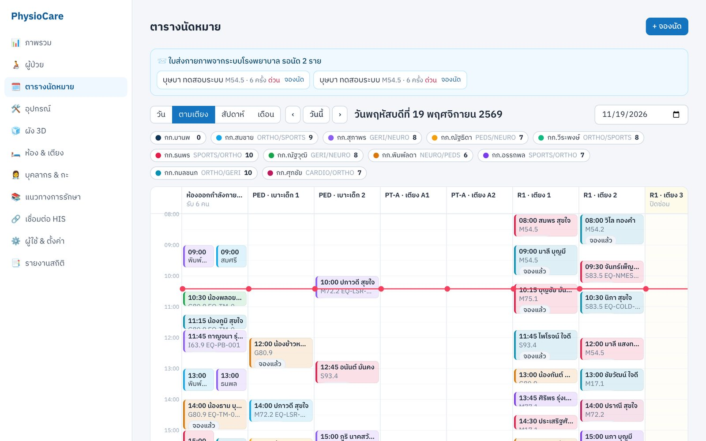

> ถ้าเชื่อมต่อ HIS ไว้ จะมีแถบสีฟ้า "ใบส่งกายภาพจากระบบโรงพยาบาล รอนัด" ที่ด้านบน กด **จองนัด** ข้างชื่อผู้ป่วยเพื่อเริ่มจองโดยไม่ต้องค้นหาเอง

# 5. จองนัด

กด **+ จองนัด** ที่หน้าตารางนัดหมาย ระบบช่วยจองให้ไม่ชนกันทั้งนักกายภาพ ผู้ป่วย อุปกรณ์ และเตียง

## ขั้นที่ 1 ค้นหาผู้ป่วย

พิมพ์ HN ชื่อ หรือเบอร์โทรอย่างน้อย 2 ตัวอักษร แล้วกดเลือกผู้ป่วย
ถ้าไม่พบ กด "ลงทะเบียนผู้ป่วยใหม่" แล้วกลับมาจองต่อ

## ขั้นที่ 2 เลือกนักกายภาพและอุปกรณ์

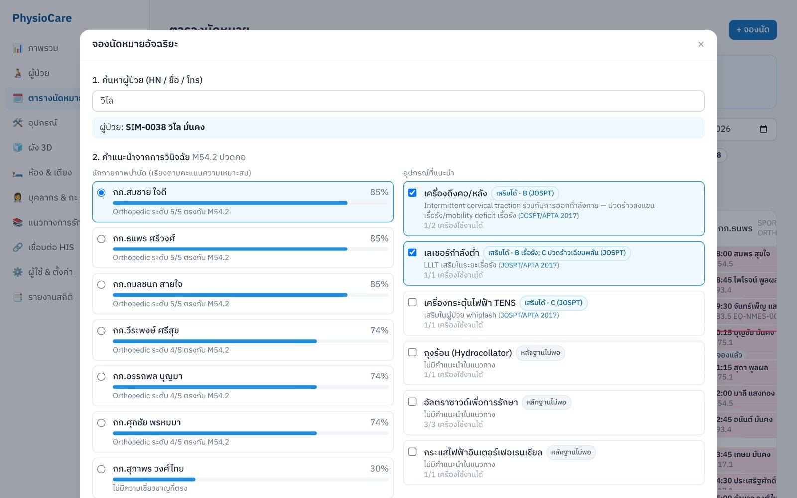

- **นักกายภาพ:** เรียงตามคะแนนความเหมาะสม (ความถนัดตรงโรค · เคยรักษาผู้ป่วยรายนี้ · ภาระงานวันนั้น · ว่าง)
  - ระบบเลือกคนที่คะแนนสูงสุดไว้ให้ เปลี่ยนได้
- **อุปกรณ์:** แสดงระดับคำแนะนำจากแนวทางเวชปฏิบัติ (แนะนำ / ใช้ได้ / หลักฐานไม่พอ / ไม่แนะนำ)
  - อุปกรณ์ที่ห้ามใช้กับผู้ป่วยรายนี้จะกดเลือกไม่ได้
  - อุปกรณ์ที่ไม่มีเครื่องพร้อมใช้จะไม่ถูกเลือกไว้ล่วงหน้า
- ใต้รายการมี**วิธีรักษาที่ไม่ใช้อุปกรณ์**ตามแนวทาง (เช่น การออกกำลังกาย) ไว้เป็นข้อมูลประกอบ

## ขั้นที่ 3 เลือกวันและเวลา

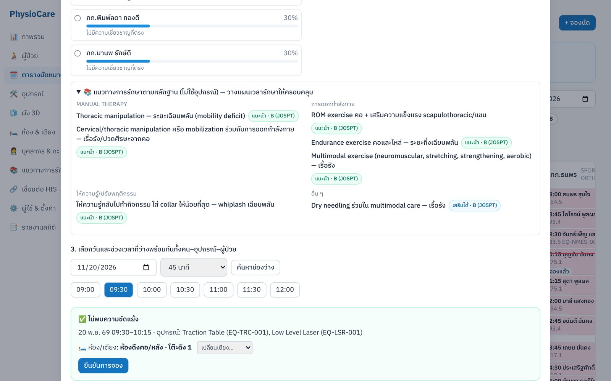

1. เลือกวันที่และระยะเวลา (ค่าเริ่มต้น 45 นาที)
2. ระบบแสดง**เฉพาะช่องเวลาที่ว่างพร้อมกัน**ทั้งนักกายภาพ ผู้ป่วย อุปกรณ์ และเตียง
3. กดช่องเวลาที่ต้องการ

## ขั้นที่ 4 ตรวจและยืนยัน

- กล่อง **ไม่พบความขัดแย้ง** (สีเขียว) แสดงเวลา อุปกรณ์ที่จองให้ และห้อง/เตียงที่ระบบจัดให้อัตโนมัติ
- ถ้าผู้ป่วยมีข้อควรระวัง ต้องติ๊ก**รับทราบข้อควรระวัง**ก่อน
- กด **ยืนยันการจอง**

ถ้าเวลาชน (เช่น มีคนจองตัดหน้าระหว่างกรอก) ระบบจะแสดงสาเหตุและ**ทางเลือก**ให้กดได้ทันที: เวลาอื่นของนักกายภาพคนเดิม นักกายภาพคนอื่นในเวลาเดิม เครื่องทดแทน หรือห้อง/เตียงอื่น

# 6. วันรักษา: สถานะนัดหมาย

คลิกนัดในตารางเพื่อเปิดรายละเอียด ปุ่มที่เห็นขึ้นกับสถานะปัจจุบัน

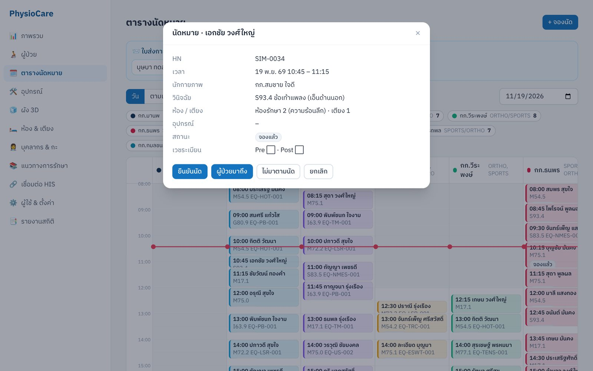

| สถานะตอนนี้ | ปุ่มที่กดได้ | ใช้เมื่อ |
|---|---|---|
| จองแล้ว | ยืนยันนัด · ผู้ป่วยมาถึง · ไม่มาตามนัด · ยกเลิก · เลื่อนนัด | โทรยืนยันกับผู้ป่วยแล้ว / ผู้ป่วยมาถึงเคาน์เตอร์ |
| ยืนยันแล้ว | ผู้ป่วยมาถึง · ไม่มาตามนัด · ยกเลิก · เลื่อนนัด | |
| มาถึงแล้ว | เริ่มรักษา · ยกเลิก | นักกายภาพรับผู้ป่วยเข้าห้อง |
| กำลังรักษา | จบการรักษา | รักษาเสร็จ อุปกรณ์และเตียงจะว่างให้คนถัดไปอัตโนมัติ |

- **ยกเลิก:** ต้องระบุเหตุผล
- **เริ่มรักษา:** ต้องบันทึก Pre-Treatment Assessment ก่อน ถ้ายังไม่บันทึก ระบบจะพาไปหน้าเวชระเบียนให้
- **📝 เปิดเวชระเบียน:** เห็นเฉพาะนักกายภาพ

## เลื่อนนัด

1. เปิดนัด → **เลื่อนนัด** (ได้เฉพาะนัดที่ยังไม่เริ่มรักษา)
2. เลือกวันที่ เวลาเริ่ม ระยะเวลา และนักกายภาพ (เปลี่ยนคนได้)
3. กด **เลื่อนนัด**

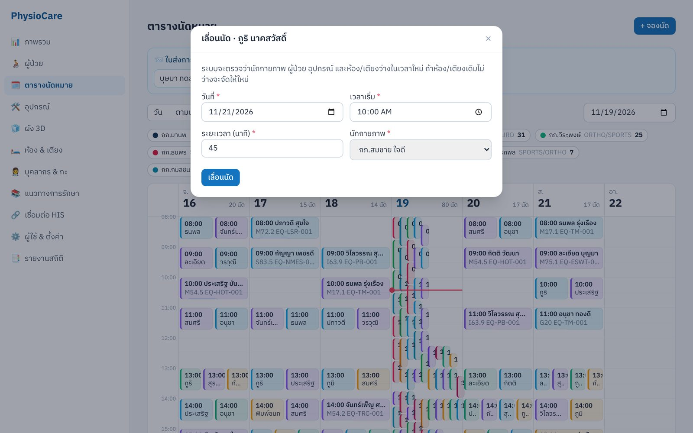

- ระบบตรวจการชนใหม่ทั้งหมด และจัดห้อง/เตียงใหม่ให้ถ้าที่เดิมไม่ว่าง
- ถ้าเวลาใหม่ไม่ว่าง ระบบบอกสาเหตุ เช่น "ไม่ได้อยู่ในกะทำงาน" หรือ "มีนัดอื่นช่วง 15:00–15:45"
  - ไม่แน่ใจว่าเวลาไหนว่าง ให้ใช้ **+ จองนัด** ดูช่องว่างก่อน แล้วค่อยกลับมาเลื่อน

# 7. เวชระเบียน (นักกายภาพ)

เปิดจากรายละเอียดนัด → **📝 เปิดเวชระเบียน** ด้านขวาแสดงข้อมูลครั้งก่อนไว้เทียบ และแนวทางการรักษาของโรคนี้

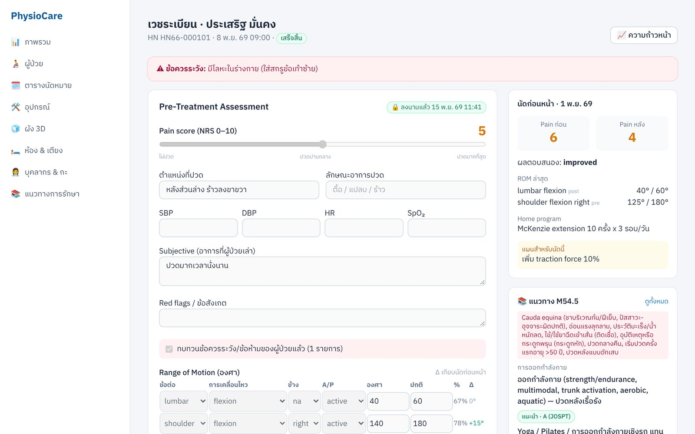

## ก่อนรักษา (Pre-Treatment Assessment)

- **Pain score (0–10)**, ตำแหน่งและลักษณะอาการปวด
- **สัญญาณชีพ:** ความดัน ชีพจร SpO₂
- **ทบทวนข้อควรระวัง/ข้อห้ามของผู้ป่วยแล้ว** (ต้องติ๊ก) และ red flags
- **Subjective / Objective**
- **Range of Motion:** กด **+ เพิ่ม ROM** เลือกข้อต่อ การเคลื่อนไหว ข้าง ชนิด (active/passive) แล้วใส่องศา ระบบแสดง % เทียบค่าปกติให้

## หลังรักษา (Post-Treatment Progress Note)

ปรากฏเมื่อเริ่มรักษาแล้ว

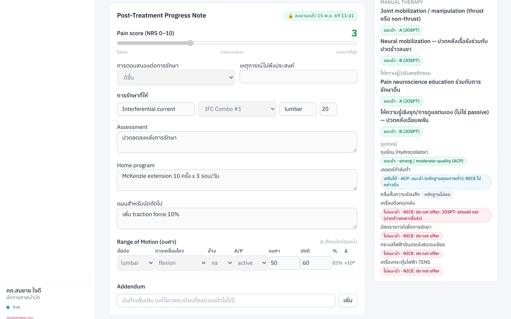

- Pain score หลังรักษา และผลตอบสนอง (ดีขึ้น / เท่าเดิม / แย่ลง)
- **+ เพิ่มการรักษา:** วิธีและอุปกรณ์ที่ใช้จริง พร้อมพารามิเตอร์
- Assessment, Plan, โปรแกรมออกกำลังกายที่บ้าน, แผนครั้งถัดไป, ROM หลังรักษา

## บันทึกแบบร่าง ลงนาม และ Addendum

- **บันทึกแบบร่าง:** เก็บไว้แก้ต่อได้
- **ลงนาม (Sign):** ยืนยันแล้ว**แก้ไม่ได้อีก** (ตามมาตรฐานเวชระเบียน)
- พิมพ์ผิดหลังลงนาม: เพิ่ม **Addendum** ใต้ฟอร์ม ระบบบันทึกผู้เขียนและเวลาไว้

## ความก้าวหน้าของผู้ป่วย

กด **📈 ความก้าวหน้า** ที่หัวหน้าเวชระเบียน เพื่อดูกราฟ Pain score ก่อน/หลังรักษาทุกครั้ง และองศาการเคลื่อนไหวเทียบครั้งแรก (baseline) และครั้งก่อน

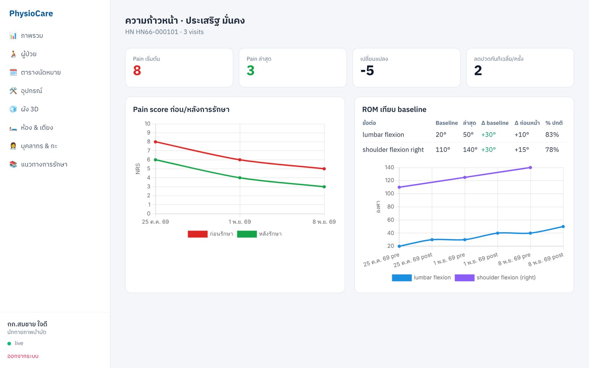

# 8. โปรแกรมกายภาพที่บ้าน (นักกายภาพ)

นักกายภาพสั่งท่าออกกำลังกายให้ผู้ป่วยทำที่บ้าน ผู้ป่วยหรือญาติเปิดลิงก์บนมือถือทุกวันเพื่อดูท่าและกดบันทึก นักกายภาพเห็นผลก่อนนัดครั้งถัดไป

## สั่งโปรแกรม

1. เปิดเวชระเบียนของนัด → การ์ด **🏠 โปรแกรมที่บ้าน** ด้านขวา → **สั่งโปรแกรมที่บ้าน**

   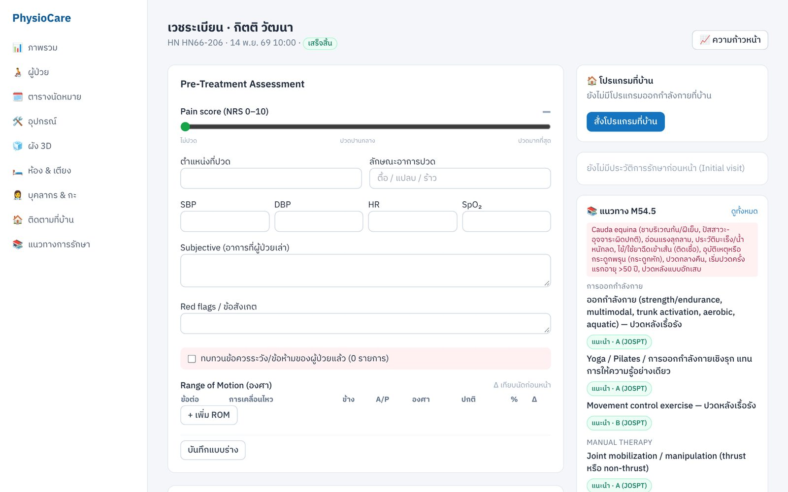

2. เลือกท่าจาก **คลังท่า** ด้านซ้าย (กรองตามส่วนของร่างกายได้) แล้วกด **+ เพิ่ม**
3. ปรับแต่ละท่า: จำนวนเซ็ต ครั้ง เวลาค้าง รอบต่อวัน **วันที่ทำ** (กดวันเพื่อเปิด/ปิด) และหมายเหตุ เช่น "ทำเฉพาะข้างซ้าย"
4. กำหนดวันเริ่ม–สิ้นสุด (ไม่เกิน 180 วัน) คะแนนปวดตั้งต้น (ระบบเติมจากเวชระเบียนครั้งนี้ให้) และระดับที่ให้แจ้งเตือนเมื่อปวดเพิ่ม (ค่าเริ่มต้น 3 คะแนน)
5. เขียนคำแนะนำถึงผู้ป่วย
6. ติ๊ก **ผู้ป่วยหรือผู้แทนยินยอม** (บังคับ ตาม PDPA) และบันทึกวิธีที่ยินยอม แล้วกด **สร้างโปรแกรม**

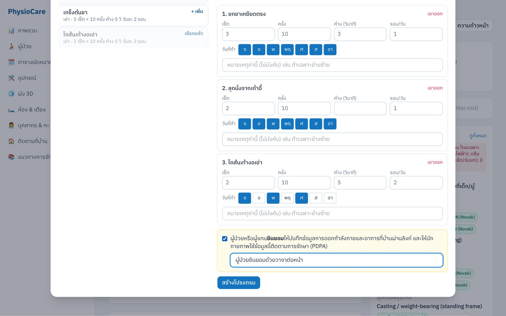

> ผู้ป่วยมีโปรแกรมที่ใช้งานได้ครั้งละ 1 โปรแกรม สั่งโปรแกรมใหม่แล้วโปรแกรมเดิมจะสิ้นสุดเอง · แก้ไขโปรแกรมได้ตลอดด้วย **แก้ไขโปรแกรม** (ท่าที่เอาออกจะหายจากหน้าผู้ป่วย แต่ประวัติการบันทึกยังอยู่)

## ส่งลิงก์ให้ผู้ป่วยหรือญาติ

หลังสร้างโปรแกรม หน้าต่าง **ลิงก์ & QR** จะเปิดให้ทันที (เปิดภายหลังได้จากการ์ดในเวชระเบียน)

1. เลือกว่าลิงก์นี้สำหรับ **ผู้ป่วย / ญาติ / ผู้ดูแล** แล้วกด **สร้างลิงก์ + QR** (แต่ละคนควรมีลิงก์ของตัวเอง)
2. เลือกวิธีส่ง:
   - **คัดลอกข้อความสำหรับ LINE/SMS:** ได้ข้อความพร้อมลิงก์ ที่ไม่ระบุโรคหรือข้อมูลการรักษา วางในแชตได้เลย
   - **พิมพ์ใบให้ผู้ป่วย:** ใบ A4 มี QR code ท่าทั้งหมดพร้อมจำนวน และสัญญาณอันตรายที่ต้องหยุด
   - **ให้ผู้ป่วยสแกน QR** บนจอได้ทันที

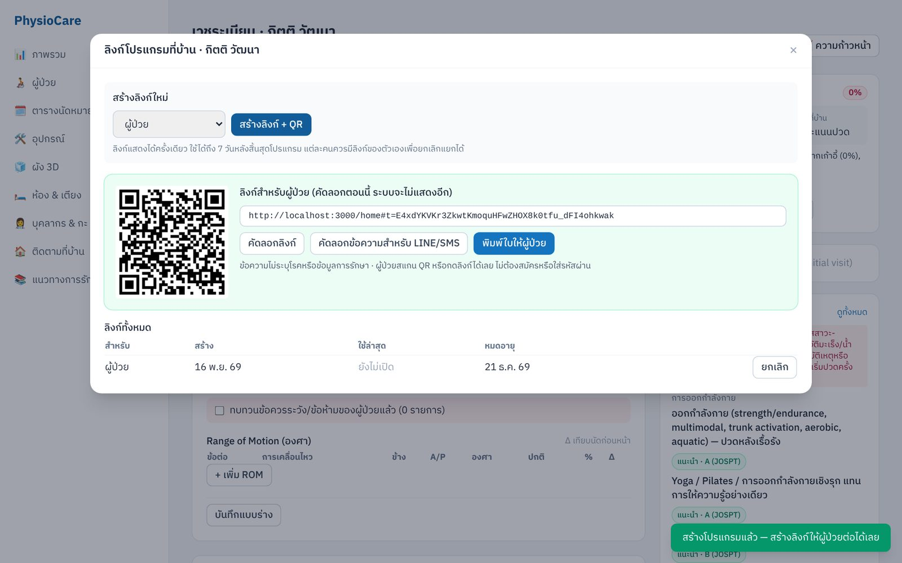

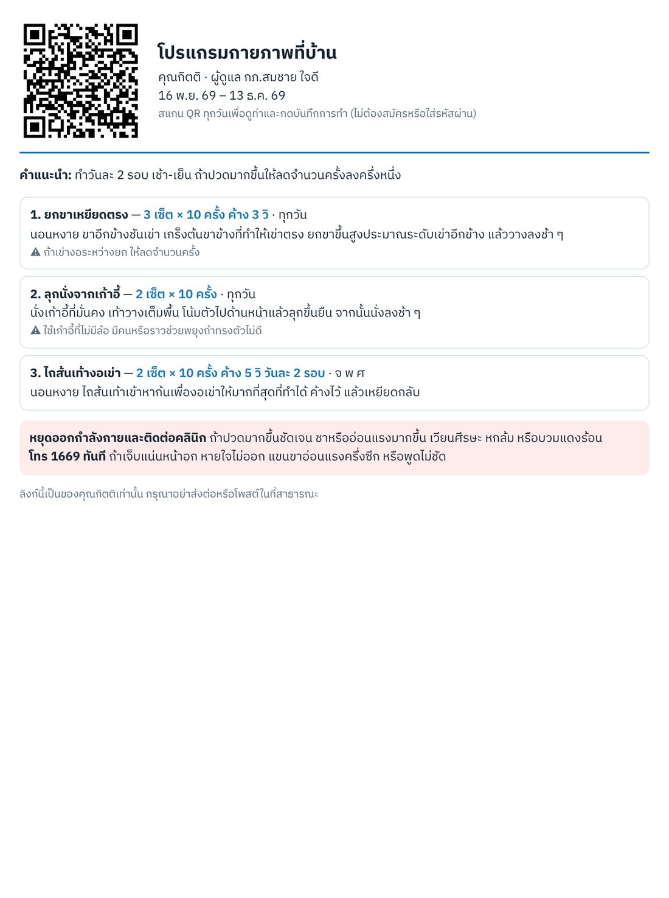

- ลิงก์**แสดงครั้งเดียว** ระบบเก็บไว้แบบเข้ารหัสทางเดียว ถ้าทำหายให้สร้างลิงก์ใหม่
- ลิงก์ใช้ได้ถึง 7 วันหลังวันสิ้นสุดโปรแกรม และกด **ยกเลิก** ได้ทันที เช่น ส่งผิดคน หรือโทรศัพท์หาย
- ตารางลิงก์แสดงว่าแต่ละลิงก์ **เปิดล่าสุดเมื่อไร** ถ้า "ยังไม่เคยเปิด" ควรโทรถามผู้ป่วย

## สิ่งที่ผู้ป่วยเห็นบนมือถือ

ผู้ป่วยกดลิงก์หรือสแกน QR ได้เลย ไม่ต้องสมัครหรือใส่รหัสผ่าน หน้าจอตัวอักษรใหญ่ บันทึกเสร็จในไม่ถึง 30 วินาที

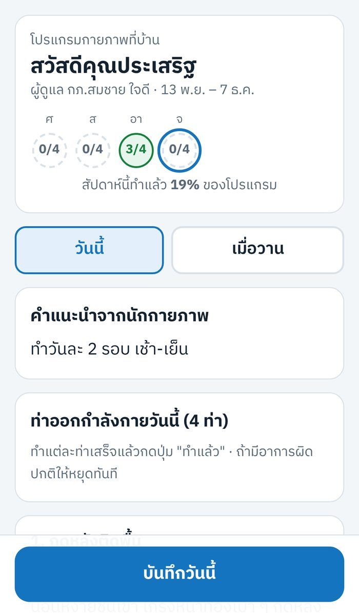

1. ดูท่าของวันนี้ พร้อมจำนวน วิธีทำ ข้อควรระวัง และวิดีโอ (ถ้ามี) · ท่าที่ไม่ได้กำหนดให้ทำวันนี้จะขึ้นว่า "วันนี้พัก"
2. ทำเสร็จแต่ละท่ากด **ทำแล้ว**
3. เลือกระดับความปวด 0–10 และความรู้สึก (ง่าย / พอดี / ยาก)
4. ติ๊กอาการผิดปกติถ้ามี แล้วกด **บันทึกวันนี้** (ลืมบันทึกเมื่อวาน กด **เมื่อวาน** แล้วบันทึกย้อนได้ 1 วัน)

ถ้าผู้ป่วยติ๊กอาการอันตราย หรือปวดเพิ่มจากตั้งต้นตามที่กำหนด หรือปวดตั้งแต่ 8 ขึ้นไป หน้าจอจะขึ้น**ให้หยุดออกกำลังกาย** พร้อมเบอร์คลินิกและเบอร์ฉุกเฉิน 1669 และระบบแจ้งนักกายภาพทันที

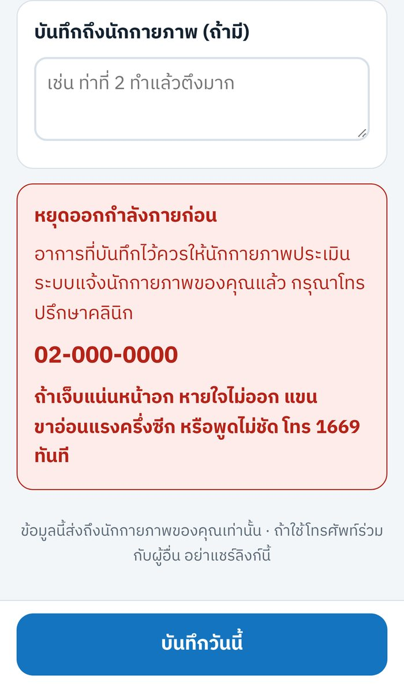

## ติดตามผู้ป่วย

เมนู **ติดตามที่บ้าน** แสดงผู้ป่วยทุกคนที่มีโปรแกรม เรียงตามสิ่งที่ควรดูก่อน: **มีแจ้งเตือน → ไม่บันทึกนาน → ทำน้อย**

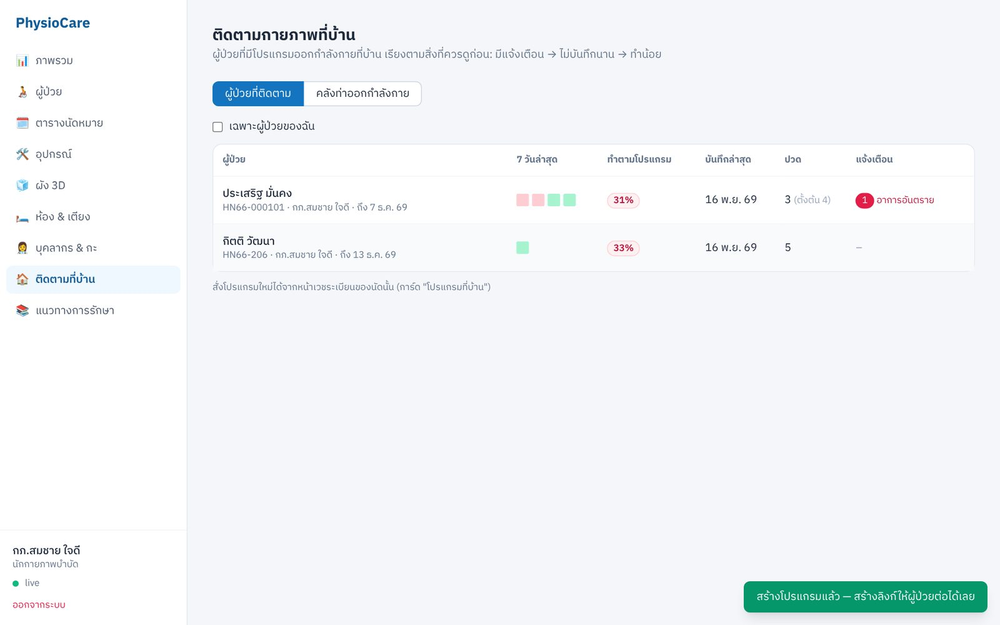

- ช่อง 7 สี่เหลี่ยมคือ 7 วันล่าสุด (เขียวเข้ม = ทำครบ, เขียวอ่อน = ทำบางท่า, ชมพู = ไม่ได้ทำ)
- **ทำตามโปรแกรม** = ท่าที่ทำ ÷ ท่าที่ต้องทำตามตาราง (วันที่ไม่บันทึกนับเป็น 0)
- ไม่บันทึกตั้งแต่ 3 วันขึ้นไปจะขึ้นสีแดง · ติ๊ก **เฉพาะผู้ป่วยของฉัน** เพื่อกรอง

คลิกผู้ป่วยเพื่อดูรายละเอียด:

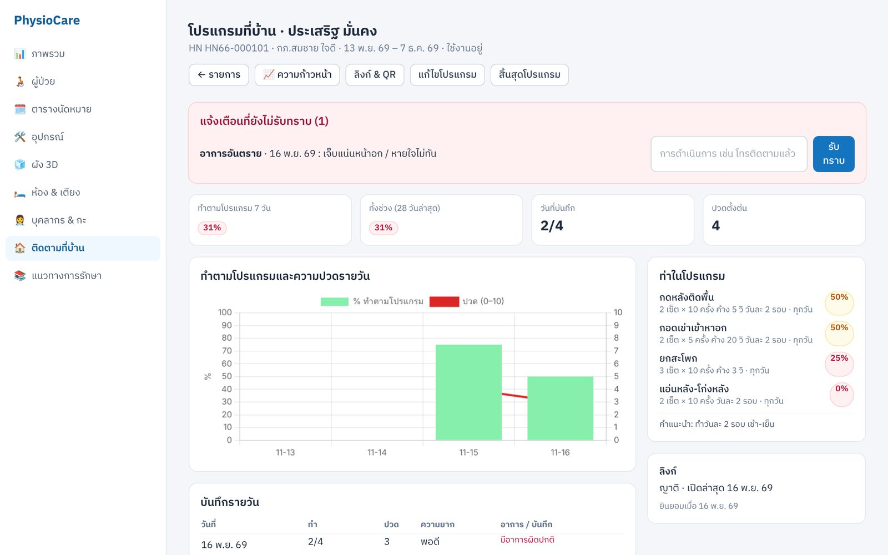

- **แจ้งเตือนที่ยังไม่รับทราบ:** อ่านอาการ ติดต่อผู้ป่วย แล้วพิมพ์สิ่งที่ทำ (เช่น "โทรติดตามแล้ว ลดจำนวนครั้ง") กด **รับทราบ**
- **กราฟรายวัน:** แท่งสีเขียวคือ % ที่ทำ เส้นแดงคือความปวดที่บ้าน
- **ท่าในโปรแกรม:** % ที่ทำของแต่ละท่า ท่าที่ข้ามบ่อยอาจยากหรือเจ็บเกินไป ควรปรับ
- **บันทึกรายวัน:** รวมความยากและข้อความที่ผู้ป่วยเขียนถึงนักกายภาพ
- **สิ้นสุดโปรแกรม:** ลิงก์ทั้งหมดใช้ไม่ได้ทันที ข้อมูลที่บันทึกแล้วยังอยู่

## สรุปก่อนนัดครั้งถัดไป

เมื่อผู้ป่วยมานัดครั้งถัดไป การ์ด **🏠 ที่บ้านตั้งแต่…** ในเวชระเบียนแสดงสรุปตั้งแต่นัดที่แล้วให้เลย:

- % ที่ทำตามโปรแกรม
- จำนวนวันที่บันทึก
- ความปวดที่บ้านครั้งแรกเทียบครั้งล่าสุด
- จำนวนวันที่รู้สึกว่ายาก
- ท่าที่ข้ามบ่อย
- แจ้งเตือนที่ค้างอยู่

หน้า **📈 ความก้าวหน้า** มีกราฟการทำที่บ้านเพิ่มใต้กราฟจากคลินิก

## คลังท่าออกกำลังกาย

แท็บ **คลังท่าออกกำลังกาย** ในเมนูติดตามที่บ้าน

- ระบบมีท่าพื้นฐาน 22 ท่าเป็นตัวอย่าง (คอ ไหล่ หลัง เข่า ข้อเท้า การทรงตัว การเดิน) **ควรให้นักกายภาพของคลินิกตรวจทานก่อนใช้**
- **+ เพิ่มท่า** / **แก้ไข:** ชื่อ วิธีทำ ข้อควรระวัง ค่าเริ่มต้น และลิงก์วิดีโอ (ต้องเป็น https)
  - แนะนำให้คลินิกถ่ายวิดีโอเอง แล้วอัปโหลดแบบไม่เป็นสาธารณะ (เช่น YouTube แบบ "ไม่เป็นสาธารณะ" หรือ Google Drive)
- ท่าที่ไม่ใช้แล้ว: เอาติ๊ก "ใช้งาน" ออก ท่าจะหายจากคลังแต่โปรแกรมเดิมยังอ้างถึงได้

# 9. อุปกรณ์

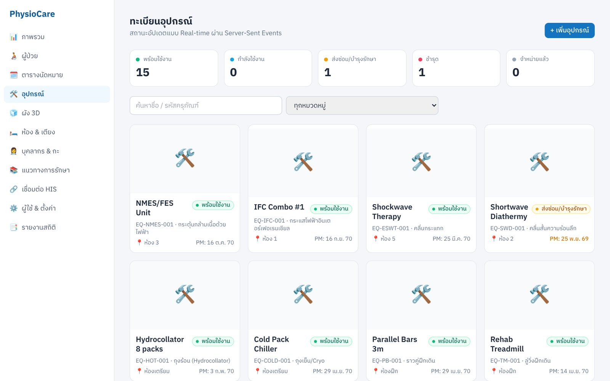

- กล่องสถานะด้านบนกดเพื่อกรองได้ (พร้อมใช้ / กำลังใช้ / ส่งซ่อม / ชำรุด / จำหน่าย) และค้นหาด้วยชื่อหรือรหัส
- สถานะ "กำลังใช้" เปลี่ยนเองตามนัดที่เริ่ม/จบรักษา

คลิกการ์ดอุปกรณ์เพื่อเปิดรายละเอียด

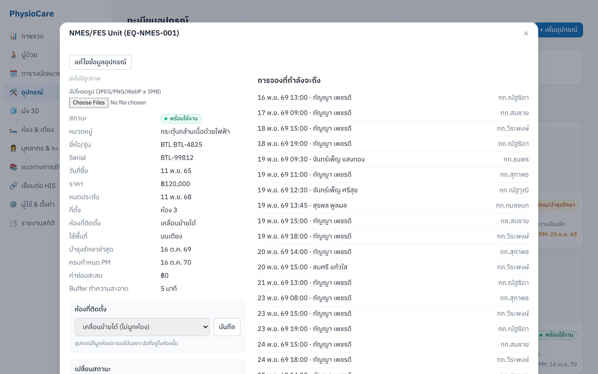

| ต้องการ | ทำอย่างไร |
|---|---|
| แจ้งชำรุด / ส่งซ่อม | เลือกสถานะใหม่ ใส่เหตุผล แล้วบันทึก ระบบแสดง**นัดที่ได้รับผลกระทบ**พร้อม**เครื่องทดแทน** ถ้าไม่มีเครื่องทดแทนต้องเลื่อนนัด |
| บันทึกการบำรุงรักษา | **+ เพิ่มรายการ** เลือกประเภท (Preventive (PM) / Corrective (ซ่อม) / Calibration / Inspection) สถานะ (นัดหมายไว้ หรือเริ่มดำเนินการ ซึ่งจะปิดเครื่องระหว่างซ่อม) ผู้ให้บริการ ค่าใช้จ่าย · ซ่อมเสร็จกด **ปิดงาน** |
| แนบรูปเครื่อง | อัปโหลดรูปในหน้ารายละเอียด (JPEG/PNG/WebP ไม่เกิน 5 MB) |
| แก้ทะเบียน (ผู้ดูแลระบบ) | **แก้ไขข้อมูลอุปกรณ์** |
| เพิ่มเครื่องใหม่ (ผู้ดูแลระบบ) | **+ เพิ่มอุปกรณ์** กรอกรหัสครุภัณฑ์ ชื่อ หมวด วันที่/ราคาซื้อ ประกัน · เลือก "ห้องที่ติดตั้ง" ถ้าเป็นเครื่องประจำห้อง (เว้นว่าง = เคลื่อนย้ายได้) |

ด้านขวามี **Timeline สถานะ** บันทึกทุกการเปลี่ยนสถานะ ใครเปลี่ยน เมื่อไร และเพราะอะไร

# 10. ห้อง & เตียง และผัง 3D

## ห้อง & เตียง

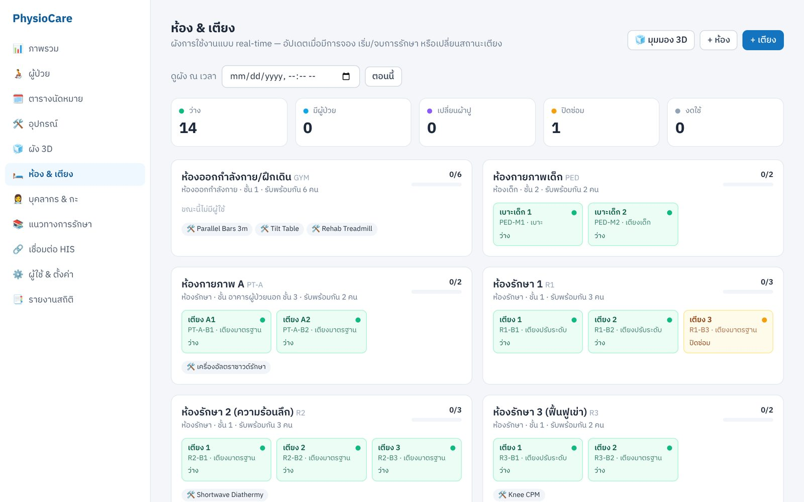

- สีของเตียงบอกสถานะ ณ เวลาที่เลือก: ว่าง / มีผู้ป่วย / เปลี่ยนผ้าปู / ปิดซ่อม / งดใช้
- เลือกเวลาด้านบนเพื่อดูช่วงอื่นของวัน หรือกด **ตอนนี้**
- **คลิกเตียง** เพื่อเปลี่ยนสถานะ (พร้อมใช้ / ปิดซ่อม / งดใช้) ระบบแสดงนัดที่ต้องย้ายเตียงพร้อมเตียงทดแทน
- ผู้ดูแลระบบเพิ่มห้องด้วย **+ ห้อง** (กำหนดประเภทและจำนวนผู้ป่วยพร้อมกันได้) และเพิ่มเตียงด้วย **+ เตียง**

## ผัง 3D

ดูคลินิกทั้งหมดในมุมมอง 3 มิติ จำลองผู้ป่วยและนักกายภาพตามนัดจริงของวันที่เลือก

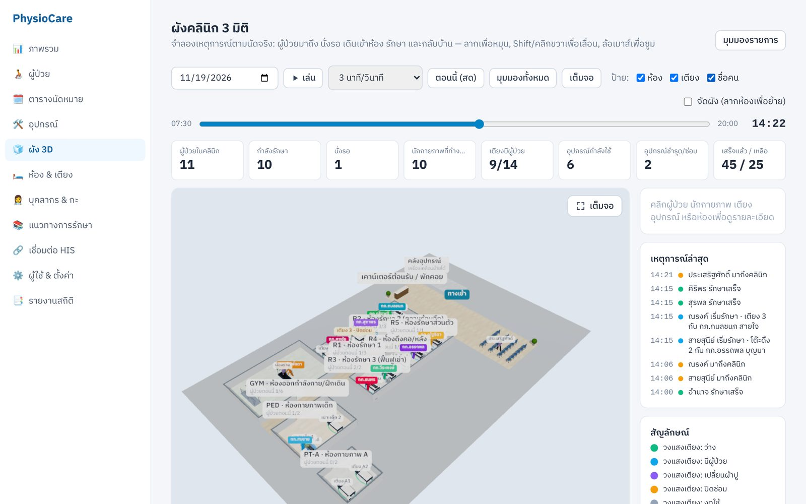

- **เมาส์:** ลากเพื่อหมุน · Shift+ลาก หรือคลิกขวาลาก เพื่อเลื่อน · ล้อเมาส์เพื่อซูม
- **▶ เล่น** และความเร็ว 1/3/10 นาทีต่อวินาที · ลากแถบเวลา · **ตอนนี้ (สด)** ตามเวลาจริง
- **ป้าย:** ติ๊กเปิด/ปิดป้าย ห้อง เตียง และชื่อคน
- **เต็มจอ:** ปุ่มมุมขวาบน (กด Spacebar เพื่อเล่น/หยุด, Esc เพื่อออก)
- **คลิกคน เตียง หรืออุปกรณ์** เพื่อดูรายละเอียด
- **ผู้ดูแลระบบ:** ติ๊ก "จัดผัง" แล้วลากห้องไปวางตำแหน่งใหม่ ระบบบันทึกให้เอง

# 11. บุคลากร & ตารางกะ

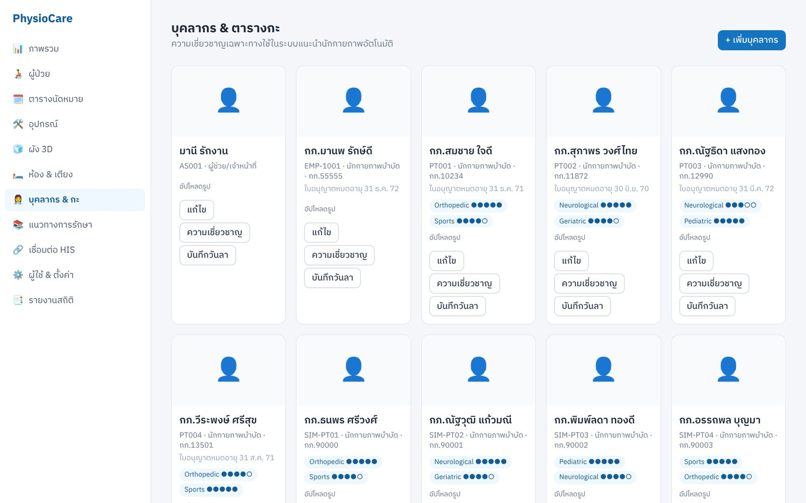

| ต้องการ | ทำอย่างไร |
|---|---|
| เพิ่มบุคลากร | **+ เพิ่มบุคลากร** (นักกายภาพต้องมีเลขใบอนุญาต) |
| กำหนดความถนัด | **ความเชี่ยวชาญ** ติ๊กสาขา (Orthopedic, Neurological, Pediatric, Sports, Cardio, Geriatric) และระดับ 1–5 ระบบใช้ข้อมูลนี้แนะนำนักกายภาพตอนจอง |
| จัดกะ | **+ สร้างกะ** เลือกแบบกะ (เช้า / บ่าย / ครึ่งวันเช้า) ช่วงวันที่ และวันในสัปดาห์ ระบบสร้างให้ทั้งช่วง และข้ามกะที่ซ้ำ |
| บันทึกวันลา | **บันทึกวันลา** ช่วงลาจะเป็นสีเทาในตารางนัด และจองไม่ได้ |
| คนลาออก | **แก้ไข** แล้วเอาติ๊ก "ใช้งานอยู่" ออก ประวัติการรักษาเดิมยังอยู่ครบ |

# 12. ผู้ดูแลระบบ

## ผู้ใช้ & ตั้งค่า

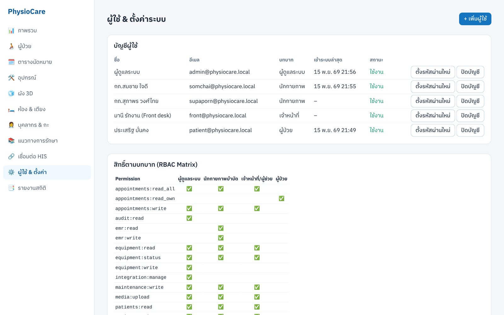

- **+ เพิ่มผู้ใช้:** ชื่อ อีเมล รหัสผ่าน และบทบาท
  - บัญชีนักกายภาพ/เจ้าหน้าที่ให้ "ผูกกับบุคลากร"
  - บัญชีผู้ป่วยให้ "ผูกกับผู้ป่วย" เพื่อให้เห็นนัดของตนเอง
- **ตั้งรหัสผ่านใหม่:** ใช้เมื่อผู้ใช้ลืมรหัสผ่าน แจ้งรหัสใหม่ทางช่องทางที่ปลอดภัย

  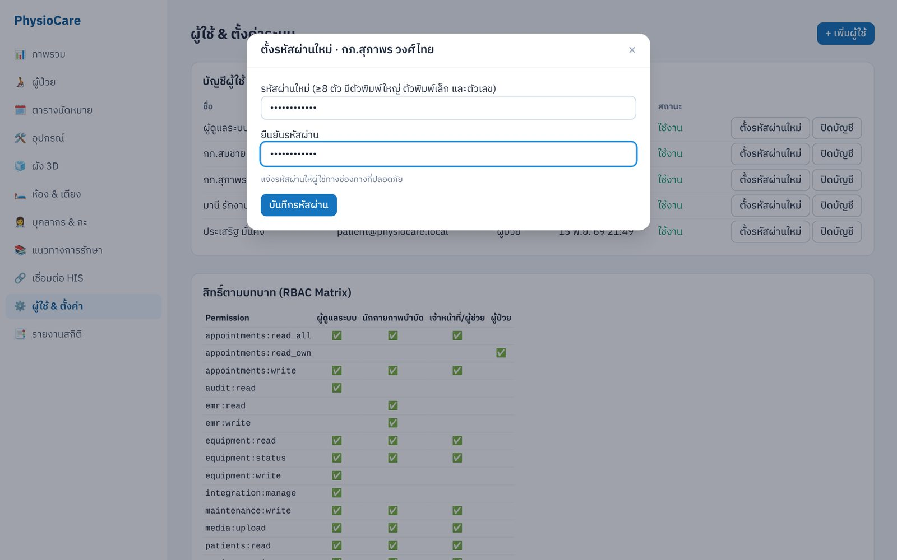

- **ปิดบัญชี:** เมื่อพนักงานลาออก (ประวัติการทำงานยังอยู่) · กด **เปิดบัญชี** เพื่อใช้อีกครั้ง
- **สิทธิ์ตามบทบาท:** ตารางแสดงว่าแต่ละบทบาททำอะไรได้

**ตั้งค่าระบบ** (แก้ค่าแล้วกด **บันทึก** ของแถวนั้น):

| ค่า | ความหมาย | ตัวอย่าง |
|---|---|---|
| `clinic.hours` | เวลาทำการ และวันที่เปิด (1 = จันทร์ … 7 = อาทิตย์) | `{"open":"08:00","close":"20:00","days":[1,2,3,4,5,6]}` |
| `scheduling.default_duration` | ระยะเวลานัดเริ่มต้น (นาที) | `45` |
| `scheduling.slot_minutes` | ความละเอียดของช่องเวลาที่แสดงตอนจอง (นาที) | `30` |
| `scheduling.bed_turnover_minutes` | เวลาเปลี่ยนผ้าปู/ทำความสะอาดเตียงหลังใช้ | `5` |
| `scheduling.auto_assign_space` | ให้ระบบจัดห้อง/เตียงเองเมื่อจองโดยไม่ระบุ | `true` |
| `emr.require_pre_assessment` | ต้องบันทึก Pre-assessment ก่อนกด "เริ่มรักษา" | `true` |
| `clinic.contact_phone` | เบอร์คลินิกที่แสดงให้ผู้ป่วยในหน้าโปรแกรมที่บ้าน เมื่อมีอาการผิดปกติ | `"02-123-4567"` |
| `home.link_days_after_end` | ลิงก์ของผู้ป่วยใช้ได้ต่อหลังวันสิ้นสุดโปรแกรมกี่วัน | `7` |

## รายงานสถิติ

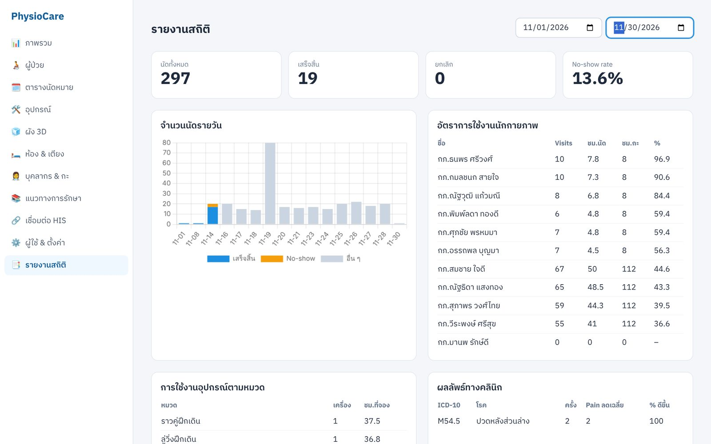

เลือกช่วงวันที่ด้านบน แล้วดู:
- ตัวเลขสรุป เช่น นัดทั้งหมด และอัตราไม่มาตามนัด (no-show)
- จำนวนนัดรายวัน
- อัตราการใช้งานนักกายภาพแต่ละคน
- การใช้งานอุปกรณ์ตามหมวด และการใช้ห้อง/เตียง
- ผลลัพธ์ทางคลินิกตามโรค (Pain score ที่ลดลง)
- งานบำรุงรักษาและค่าใช้จ่าย

## เชื่อมต่อระบบโรงพยาบาล (ไม่บังคับ)

ใช้เมื่อคลินิกอยู่ในโรงพยาบาลและต้องการรับข้อมูลห้อง เตียง บุคลากร อุปกรณ์ ผู้ป่วย และใบส่งกายภาพจาก HIS โดยไม่ต้องกรอกซ้ำ

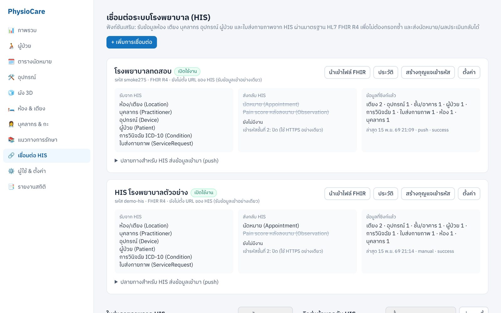

- **+ เพิ่มการเชื่อมต่อ** แล้ว**คัดลอก API key เก็บไว้** (แสดงครั้งเดียว)
- **นำเข้าไฟล์ FHIR:** ทดลองนำเข้าก่อนเสมอ ระบบแสดงว่าแต่ละรายการจะสร้างใหม่ ผูกกับข้อมูลเดิม หรือผิดพลาดเพราะอะไร แล้วจึงกด **นำเข้าจริง**
- รายละเอียดทางเทคนิคสำหรับฝ่าย IT โรงพยาบาล อยู่ในเอกสาร "ข้อกำหนดการเชื่อมต่อระบบ PhysioCare กับระบบโรงพยาบาล (HIS)"

# 13. แนวทางการรักษา

เมนู **แนวทางการรักษา** รวมแนวทางเวชปฏิบัติของ 13 โรคที่พบบ่อยในงานกายภาพ อ้างอิงจาก 21 แหล่ง เช่น JOSPT/APTA, NICE, ACP, OARSI, AHA/ASA

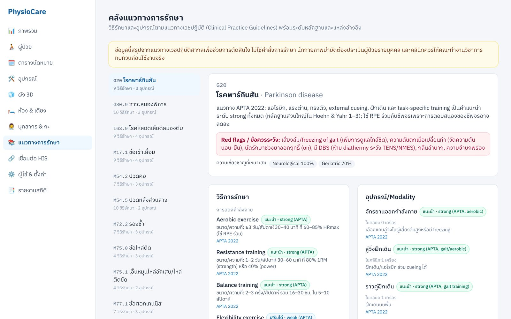

แต่ละโรคแสดง:
- red flags ที่ต้องส่งต่อแพทย์
- วิธีรักษาที่ไม่ใช้อุปกรณ์พร้อมขนาด/ความถี่
- อุปกรณ์พร้อมระดับคำแนะนำและเกรดหลักฐาน
- ลิงก์ไปยังแหล่งอ้างอิง

ข้อมูลชุดเดียวกันนี้แสดงในหน้าจองนัดและหน้าเวชระเบียนด้วย

> แนวทางเป็นข้อมูลประกอบการตัดสินใจทางคลินิก การรักษาจริงขึ้นกับการประเมินของนักกายภาพ

# 14. สำหรับผู้ป่วย

ผู้ป่วยที่คลินิกเปิดบัญชีให้ เข้าสู่ระบบด้วยอีเมลและรหัสผ่านที่ได้รับ แล้วจะเห็นหน้า **นัดหมายของฉัน**

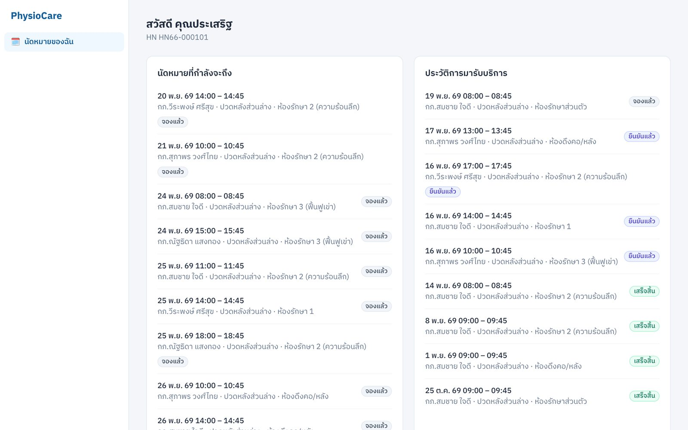

- **นัดหมายที่กำลังจะถึง:** วัน เวลา นักกายภาพ และห้อง
- **ประวัติการมารับบริการ:** สถานะของแต่ละนัด
- ผู้ป่วยเห็นเฉพาะนัดของตนเอง ไม่เห็นข้อมูลผู้ป่วยคนอื่นหรือรายละเอียดภายในของคลินิก
- ต้องการเลื่อนหรือยกเลิกนัด ให้โทรแจ้งคลินิก
- **โปรแกรมกายภาพที่บ้าน:** ผู้ป่วยและญาติใช้ลิงก์หรือ QR code ที่นักกายภาพให้ ไม่ต้องเข้าสู่ระบบ (ดูหัวข้อ 8)

# 15. คำถามที่พบบ่อย

| ปัญหา | สาเหตุและวิธีแก้ |
|---|---|
| จองนัดแล้วไม่มีช่องเวลาให้เลือก | นักกายภาพไม่มีกะวันนั้น ลา หรือเต็ม · อุปกรณ์ที่เลือกไม่มีเครื่องว่าง · ลองเปลี่ยนวัน นักกายภาพ หรือเอาอุปกรณ์บางอย่างออก ตรวจกะที่เมนูบุคลากร & กะ |
| กด "เริ่มรักษา" ไม่ได้ | ยังไม่ได้บันทึก Pre-Treatment Assessment ระบบจะพาไปหน้าเวชระเบียนให้ |
| แก้เวชระเบียนไม่ได้ | ลงนามแล้ว ให้เพิ่ม Addendum แทน |
| เลือกอุปกรณ์บางตัวไม่ได้ | ห้ามใช้กับข้อควรระวังของผู้ป่วยรายนี้ หรือไม่มีเครื่องพร้อมใช้ |
| ช่องในฟอร์มเป็นสีเทาแก้ไม่ได้ | ข้อมูลนั้นมาจากระบบโรงพยาบาล ให้แก้ที่ HIS |
| แจ้งชำรุดแล้วนัดของเครื่องนั้นต้องทำอย่างไร | ดูรายการ "นัดที่ได้รับผลกระทบ" ถ้ามีเครื่องทดแทนใช้ได้ทันที ถ้าไม่มีให้เลื่อนนัด |
| ข้อมูลไม่อัปเดต / จุด live ไม่เป็นสีเขียว | การเชื่อมต่อหลุดชั่วคราว ระบบเชื่อมต่อใหม่เองภายในไม่กี่วินาที หรือกดรีเฟรชหน้า |
| ถูกให้เข้าสู่ระบบใหม่ระหว่างใช้งาน | ครบ 8 ชั่วโมง เข้าสู่ระบบใหม่ได้เลย ข้อมูลที่บันทึกแล้วไม่หาย |
| ลืมรหัสผ่าน / บัญชีถูกล็อก | แจ้งผู้ดูแลระบบให้ตั้งรหัสผ่านใหม่ |
| ผู้ป่วยเปิดลิงก์โปรแกรมที่บ้านไม่ได้ | ลิงก์หมดอายุ ถูกยกเลิก หรือโปรแกรมสิ้นสุดแล้ว · สร้างลิงก์ใหม่ที่ **ลิงก์ & QR** · ถ้าคัดลอกลิงก์ไม่ครบ ให้สแกน QR แทน |
| ทำลิงก์ของผู้ป่วยหาย | สร้างลิงก์ใหม่ได้เลย (ระบบไม่เก็บลิงก์เดิมไว้ให้ดูซ้ำ) และยกเลิกลิงก์เดิมถ้ากังวลว่าคนอื่นได้ไป |
| ไม่มีปุ่ม "สั่งโปรแกรมที่บ้าน" | ต้องเป็นบัญชีนักกายภาพ (สิทธิ์บันทึกเวชระเบียน) |
